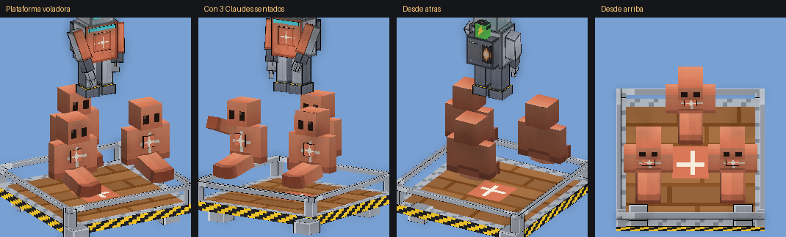
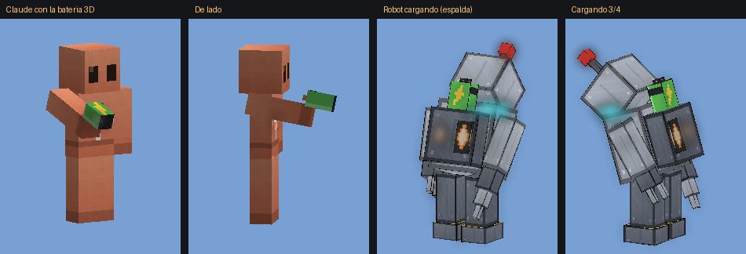
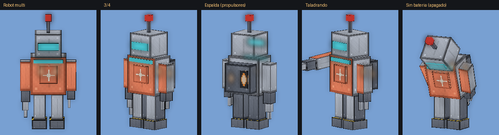

# Claude NPC — Bedrock 1.21.132 (y versiones nuevas)

NPCs con forma de Claude: personaje naranja con ojos que parpadean y un emblema de estrella luminoso, de diseño propio (no es el logo oficial). **Cada Claude tiene su propia personalidad** y hace lo que quiere: pelea con espada y escudo, construye, mina, tala, pesca, cultiva, rema en bote, se hace su casa y va a clase con **Claude Maestro** o con maestros genios (Einstein, Tesla, Curie, Newton y Lovelace). Lo que estudian en clase se vuelve **habilidades con niveles** (redstone, reflejos, construcción, arco, perlas, vuelo, química...) y cada nivel desbloquea una variante nueva. Cuando se juntan dos o tres maestros construyen una **escuela, preparatoria o universidad**. Su IQ sube hasta 1000: con **IQ 500**, cinco Claudes construyen un **robot** y lo manejan; con **IQ 1000**, cinco Claudes se fusionan en **Claude Golden**. Además está el **Robot multi**, un robot constructor con batería que aplana el terreno de los maestros y, en la pelea, construye rampas, puentes y túneles para que los Claudes te alcancen. Y desde la v10, **Claude Exponencial Infinito**: un Claude que no construye y solo pelea, que no se mide por IQ sino por **DETERMINACIÓN** y sube por 20 fases de combate. Namespace `claudenpc`.

## Instalación

1. Abre `dist/ClaudeNPC.mcaddon` con Minecraft y activa el paquete de comportamiento en el mundo.
2. Genera a Claude con el huevo "Generar a Claude" y al maestro con "Generar a Claude Maestro" (o `/summon claudenpc:claude` y `/summon claudenpc:maestro`).
3. Para que te ataquen: estar en Supervivencia o Aventura (ya no hace falta activar el PvP o "fuego amigo"; si quieres que lo respeten, pon `COMBATE.respetarPvP = true` en `BP/scripts/config.js`).
4. Comandos (operador): `/claudenpc:clase` hace que el maestro más cercano empiece la clase ya; `/claudenpc:maestro einstein` (o `tesla`, `curie`, `newton`, `lovelace`, `maestro`) trae a ese maestro (con trucos); `/claudenpc:iq 500` o `/claudenpc:iq 1000` (con trucos) pone el IQ de los Claudes cercanos, para probar el robot o la fusión con 5 Claudes; `/claudenpc:robot` (con trucos) hace que los Claudes más cercanos (hasta 5, con cualquier IQ) construyan el robot ya.
5. Claude Exponencial Infinito: huevo "Generar a Claude Exponencial Infinito", `/summon claudenpc:exponencial_infinito` o `/claudenpc:infinito [fase]` (con trucos). Ver las secciones de la v10.2, la v10.1 y la v10.
6. **Toca a un Claude** (botón "Habilidades" en el celular) para ver qué sabe: cada tema con sus estrellas, la última variante que aprendió y si lo perfecciona o solo lo estudia.

## Novedades de la v10.2: en la gráfica, la cabeza de Claude y la tuya (con tu skin)

| Antes (v10.1) | Ahora |
|---|---|
| Claude cambiaba a una cara estilo Saitama, tú llevabas una máscara estilo Garou y en la gráfica subían dos caras dibujadas | **Nadie se cambia la cara.** En la gráfica suben **las cabezas de verdad**: en lugar de la de Saitama, **la de Claude** (Claude Exponencial Infinito, con sus ojos rojos y su cinta de la fase 20), y en lugar de la de Garou, **la tuya, con tu propia skin** (Steve, Alex, una del Marketplace, una hecha en el creador de personajes o la que uses). Se quitaron la cara de Saitama, la máscara y los dibujos de caras. |

### Cómo es ahora la cinemática de la fase 20

Dura unos 13 s y la ven todos los jugadores a 48 bloques:

1. **Fundido** y toma por encima de tu hombro: Claude junta su determinación (gesto, sonido y destello blanco).
2. **La gráfica**: fondo negro con cuadrícula y ejes verdes **PODER (Y)** y **TIEMPO (X)**. Se dibujan dos curvas blancas y en la punta de cada una sube una cabeza: **la tuya** crece despacio; **la de Claude** va por debajo hasta que **se dispara hacia arriba**. Al llegar arriba su cabeza crece un poco más, sale un **destello blanco** y, a su lado, **"TOP 1" en letras rojas con borde negro, sin marco**.
3. **Fundido**: cada uno vuelve a su lugar y **chocan los puños**, de lado, con energía roja, explosión y temblor de cámara, y otra vez "TOP 1" al lado de su cabeza.
4. **Fundido** y sigue la pelea (con su aura de la fase 20). Al final sale "INFINITE DETERMINATION".

**Cómo sale tu cabeza con tu skin:** Minecraft no deja poner la skin de un jugador en una partícula ni en otro modelo, así que en la gráfica estás **tú de verdad**. Durante esa toma (unos 7 s) subes a la gráfica (la cámara está en otro lado, así que no lo notas) y una animación te **agranda la cabeza hasta que tapa todo tu cuerpo**: solo se ve tu cabeza, con tu skin. A Claude le pasa lo mismo. Cuando termina la toma, con la pantalla en negro, cada uno vuelve **exactamente adonde estaba** y la cabeza vuelve a su tamaño.

- **Tu casco**: mientras estás en la gráfica se guarda en un hueco libre de tu inventario (para que se vea tu cara) y al bajar vuelve a tu cabeza (el mismo, con sus encantamientos). Si tu inventario está lleno, subes con el casco puesto.
- Arriba tienes caída lenta y la protección de la cinemática: no recibes daño ni te mueves.
- Claude sube sin casco, sin el "DETERMINACIÓN" de encima y sin aura (para que se vea su cara); al bajar recupera todo.
- Si sales del mundo a media toma, al volver a entrar bajas adonde estabas y recuperas tu casco. Si el mundo se cierra con Claude arriba, al cargarlo vuelve a su lugar.
- En multijugador los demás ven la misma toma con tu cabeza (y quizá tu nombre encima de ella).

Para verla otra vez: cerca de él, `/claudenpc:fase 19` y luego `/claudenpc:fase 20`.

> **Fan-made:** inspirada en el meme de la gráfica del poder que crece de forma exponencial; no usa imágenes del anime ni del video, y el add-on no es oficial ni está afiliado a nadie. Vista previa: `source/vista_v102_cinematica.png` (dibujo hecho con las posiciones reales del simulador y una cámara de 70°; la cabeza del jugador lleva una skin de ejemplo hecha aquí; no es una captura del juego).

> **Sonidos:** solo de Minecraft (no se agregó ningún archivo de audio). La música y los sonidos que mandaste antes siguen siendo para tu mundo: si vas a publicar el add-on, cámbialos por sonidos propios o con permiso.

### Estado de la v10.2

- **GENERATED** y **STATICALLY_VALIDATED**: tipos oficiales 2.4.0 sin errores (`playAnimation` con controlador, teletransporte con giro, efectos, propiedades del jugador, casco e inventario), validador del kit y auditoría 1.21.132 con 0 errores y 0 advertencias, cruce de referencias igual que antes.
- **Simulado fuera del juego**: **148 comprobaciones**, **40 corridas seguidas sin fallas** (dos tandas de 20). Las nuevas: que ya no hay caras dibujadas ni cambio de cara; que tú y Claude suben con la animación de cabeza grande y al bajar vuelve la normal; que cada cabeza va en la punta de su curva, de izquierda a derecha, en el plano de la gráfica (la de Claude, un poco más cerca), mirando a la cámara; que la de Claude termina unos 8 bloques más arriba que la tuya; que tu casco queda en el inventario mientras tanto y vuelve el mismo; que Claude sube sin casco, sin nombre y sin aura y al bajar los recupera; que cada uno vuelve a su lugar y se borra el dato de la vuelta; que "TOP 1" queda a la derecha de su cabeza y arriba; que con el inventario lleno subes con tu casco; que si el Infinito desaparece a la mitad bajas a tu lugar; que al volver a entrar al mundo bajas y recuperas tu casco; y que si el mundo se cierra con Claude arriba, al cargar vuelve a su lugar. Las simulaciones anteriores siguen pasando.
- **IN_GAME_TESTED: no.** Revisa en el juego: que tu cabeza agrandada tape todo tu cuerpo y lo que tengas en las manos (con skins normales y del creador de personajes debería; una skin con geometría propia puede verse distinta), que Claude también se vea solo como cabeza, que no tiembles allá arriba, que vuelvas a tu sitio con tu casco, y que la gráfica tape toda la pantalla con tu campo de visión.

## Novedades de la v10.1: más determinación, pelea más humana y la cinemática de la fase 20

| Antes (v10.0) | Ahora |
|---|---|
| La determinación subía con lo que él hacía | **También sube cuando le pegas**: cada punto de daño que le haces le da 0,5 de determinación (× ritmo, y × 1,5 si tiene poca vida). Cuanto más le pegas, más rápido evoluciona. |
| Al "matarlo" quedaba derribado, pero si el Claude que venía moría o no había dónde hacer aparecer uno, se recuperaba solo; y si moría de verdad, se perdía | Al "matarlo" queda derribado y **siempre viene un Claude a llevárselo**: a los 12 s sale a buscarlo el Claude libre más cercano (a 48 bloques) o aparece uno que llega corriendo; si no hay suelo lejos (mar, Nether, acantilados), aparece a su lado; si no encuentra camino, llega con una perla; y si el que venía muere o se pierde, viene otro. Si algo lo mata de verdad (lava, el vacío, algo que el sensor no paró), **reaparece derribado** con todo lo que sabía y también se lo lleva un Claude. Solo el sello lo elimina (o `/kill`, si de verdad quieres quitarlo). |
| Encima de la cabeza: nombre, fase, barra y frases | **Solo "DETERMINACIÓN 1234"**. Sus frases salen abajo, en la barra de acción de los que están cerca. |
| Pelea robótica: retrocedía para guardar distancia y se quedaba quieto | **Pelea como un jugador**: **corre saltando** hacia ti en todas las fases (el NOOB, más torpe); ya cerca **te rodea** cambiando de lado y vuelve a entrar, **sin quedarse quieto**; **ya no retrocede para guardar distancia** (solo da un paso atrás rápido después de golpear, se aleja en algunos combos desde la fase 11 —lava, "alternar distancia", TNT y cristal— y se retira con muy poca vida); te observa como mucho 1,2 s dando vueltas; se cubre con el escudo menos seguido y por menos tiempo; el **arco** solo si estás muy lejos (más de 18 bloques; desde la fase 12, más de 12) y después de dos tiros vuelve a perseguirte; se retira solo con menos del 10-20 % de vida. |
| La fase 20 tenía un título | **Cinemática de la fase 20** (en la v10.2 cambió: ver arriba). |

### Cinemática de la fase 20 (v10.1)

En la v10.1 la gráfica usaba caras dibujadas (una cara estilo Saitama para él y una máscara estilo Garou para ti). **Desde la v10.2 van las cabezas de verdad** (la de Claude y la tuya con tu skin): ver la sección de la v10.2.

### Estado de la v10.1

- **GENERATED** y **STATICALLY_VALIDATED**: tipos oficiales 2.4.0 sin errores (incluía la máscara, que se quitó en la v10.2, el casco y el inventario), validador del kit y auditoría 1.21.132 con 0 errores y 0 advertencias, cruce de referencias igual que antes.
- **Simulado fuera del juego**: el simulador ahora tiene la Resistencia de las cinemáticas, el inventario y el casco del jugador. **134 comprobaciones**: las de la v10 más que corre saltando en las fases 1, 5, 7 y 12, que no retrocede, que casi nunca se queda quieto (0-5 % del tiempo, sin contar los 2 ticks del W-tap), la determinación al recibir daño, que reaparece derribado si muere de verdad (y con `/kill` no), que si no hay suelo lejos el rescatista aparece a su lado, que si el que venía muere viene otro y se lo lleva, y la cinemática completa (cara, máscara con el casco guardado y devuelto, 80 trazos, caras subiendo, destello, "TOP 1" a la derecha de la cara y arriba, choque, sin daño al jugador y la pelea que sigue). **40 corridas seguidas sin fallas** (dos tandas de 20). Las simulaciones anteriores siguen pasando.
- **IN_GAME_TESTED: no.** Revisa en el juego que el movimiento con impulsos se vea fluido (lo de la cinemática está en la sección de la v10.2).

## Novedades de la v10.0: Claude Exponencial Infinito (INFINITE DETERMINATION)

Un Claude nuevo que **no construye**: es un maestro del combate. No se mide por IQ sino por **DETERMINACIÓN**, y su "exponencial infinito" es la experiencia de combate que va juntando. Empieza como **NOOB** (espada de madera, golpes lentos, falla y no esquiva) y, peleando, sube por **20 fases** hasta **INFINITE DETERMINATION**. Lo que cambia en cada fase es **cómo piensa** (cuándo ataca, cómo se mueve, qué arma elige, qué combo usa y cómo se adapta a ti), no solo su vida y su daño. **No muere**: con poca vida queda derribado y un Claude lo lleva a recuperarse. La única forma de vencerlo para siempre es **sellarlo**. Proyecto fan-made: la idea de la DETERMINACIÓN viene de Undertale, pero el modelo, las texturas, las partículas y las animaciones son propias.

### Cómo invocarlo y cómo poner una fase

| Para | Haz |
|---|---|
| Invocarlo | Huevo **"Generar a Claude Exponencial Infinito"**, `/summon claudenpc:exponencial_infinito` o **`/claudenpc:infinito`** (aparece delante de ti, con trucos). `/claudenpc:infinito 12` lo trae ya en la fase 12. |
| Cambiarle la fase | **`/claudenpc:fase <1-20>`** al más cercano (32 bloques). |
| Cambiarle la determinación | **`/claudenpc:determinacion <valor>`** (la fase se calcula sola). |
| Ver qué piensa | **`/claudenpc:infinito_info`**: fase, determinación, estado, arma, estilo, niveles, estrategias que aprendió contra ti, bloques que puso y los últimos errores. |
| Que evolucione solo | Pelea con él (o déjalo pelear con monstruos): cada golpe, crítico, combo, bloqueo, esquiva, patrón que te descubre o remontada le da determinación. |

Te ataca si estás en Supervivencia o Aventura a 24 bloques (te sigue hasta 40). Si no hay jugadores, pelea con monstruos a 16 bloques. Nunca ataca a los Claudes ni ellos a él.

### Las 20 fases

| Fase | Nombre | Lo nuevo (se acumula) |
|---|---|---|
| 1 | NOOB | Camina directo, golpea lento (cada 1,5 s), falla a veces, no esquiva ni bloquea |
| 2 | APRENDIZ | Guarda distancia, escudo, salta antes de atacar, críticos |
| 3 | NOVATO | Corre y golpea, combos simples, arco, sabe si está muy cerca o muy lejos |
| 4 | COMBATIENTE | Espada y escudo, retrocede, cambia de objetivo, come para curarse |
| 5 | GUERRERO | Hacha, cadenas, castiga errores, persigue, se reposiciona |
| 6 | DUELISTA | Intercambios, control de distancia, fintas y golpes retrasados, se adapta |
| 7 | ESPECIALISTA EN ESPADAS | Combos rápidos, strafe, sprint reset, W-tap, S-tap, alcance exacto |
| 8 | ESPECIALISTA EN HACHAS | Hacha y escudo, golpes pesados, rompe defensas, cambia de arma |
| 9 | ESPECIALISTA EN MOVILIDAD | Saltos estratégicos, cambios de dirección, altura, perlas, jump reset, zigzag |
| 10 | MAESTRO DE COMBOS | Combos con varias armas sin repetirse; corta su combo si lo contraatacas |
| 11 | MAESTRO DE CUBETAS | Water clutch / MLG, agua para frenarte, lava de control |
| 12 | MAESTRO DE PROYECTILES | Ballesta, tridente, predicción, alterna distancia y cuerpo a cuerpo |
| 13 | MAESTRO DE TNT Y CRISTAL | TNT y cristal con tiempo y distancia (nunca rompen bloques) |
| 14 | MAESTRO DE MACE | Maza, ataque vertical, pilar de bloques para ganar altura |
| 15 | MAESTRO MULTIMODAL | Estilos: espada, hacha, 1.8, 1.9+, UHC, pociones, SMP, maza, arco, tridente, cubetas, cristal |
| 16 | COMPETIDOR PROFESIONAL | Analiza tus patrones, contrarresta combos, rompe su propio ritmo |
| 17 | ÉLITE | Usa el terreno (altura, no dejarse acorralar), sabe cuándo escapar (perla) |
| 18 | TOP 10 | Cambia de estilo durante la pelea; predice tus patrones |
| 19 | TOP 1 | Anticipa; nunca repite una estrategia que ya le contrarrestaste |
| 20 | INFINITE DETERMINATION | Todo junto, su combo infinito (se arma con lo que mejor le funcionó contra ti), aura roja, nunca se retira |

Aspecto por tramo (vista previa: `source/vista_v10.png`): fases 1-5 con el corazón rojo en el pecho; 6-10 con cinta roja en la frente; 11-15 con bufanda; 16-19 con hombreras doradas, el símbolo del infinito y un ojo que brilla; 20 oscuro con vetas rojas, ojos rojos brillantes y **aura**. Arma y armadura según la fase: madera → piedra → hierro → diamante → netherita.

### Determinación

- **Umbral de cada fase**: `12 × (1,4^(n−1) − 1)`. Fase 2 con 5, fase 5 con 34, fase 10 con 236, fase 15 con 1 321, fase 20 con 7 160. Tope: 21 479 (3 veces la fase 20).
- **Ganancias**: golpe 1, crítico 2, combo 2 (+0,25 por golpe acertado), bloqueo 1,5, esquiva 1, aguantar 10 s contra alguien con mejor armadura 3, patrón nuevo descubierto 4, estrategia nueva que funciona 4, remontada (de menos de 25 % a más de 50 % de vida) 10, levantarse después de un rescate 25, ganar 20 × (1 + fase/10), matar un monstruo 3. Todo × `ritmo` (1,5) y × 1,5 si pelea con poca vida.
- **Límites**: fase 20, determinación máxima, como mucho 900 por combate, vida 40/52/64/72/80 por tramo, daño del arma × (1 + 0,02 por fase) hasta × 1,4. **Su fuerza está en las decisiones**, no en la vida.
- Todo se ajusta en `BP/scripts/infinito/config.js` (`INFINITO_CFG` y `GANANCIA`), sin tocar la lógica.

### Memoria, adaptación y máquina de estados

- **Memoria por rival** (hasta 6 a la vez, y por nombre al cerrar el mundo): si saltas mucho, si te cubres con escudo, si usas arco, si escapas, si eres agresivo, tu armadura, tus armas, tu ritmo de golpes y **qué haces después de qué** (secuencias de 3). También qué combos le funcionaron contra ti y cuáles le contrarrestaste. Se va olvidando con el tiempo.
- **Adaptación**: los combos que le funcionan pesan más y los que fallan menos; contra un escudo usa el hacha y los rompeguardias; contra quien salta usa S-tap; contra un arquero se acerca en zigzag o con perla. Desde la 15 elige un **estilo** según tú; desde la 16 **anticipa** tu próxima acción; en la 19 prohíbe lo que ya le contrarrestaste.
- **Estados**: `IDLE → OBSERVING → APPROACHING → ENGAGING → COMBO → DEFENDING → COUNTERING → RETREATING → RECOVERING → ADAPTING`, con prioridades (emergencias → adaptarse → defenderse → el estado actual) y al menos 8 ticks por estado salvo urgencias. Observa antes de atacar (más tiempo en fases altas), decide cada 30 ticks en la fase 1 y cada 4 en la 20.

### Combos (36, ampliables)

Cada combo es un objeto de datos con sus pasos, y cada paso es una **acción real** (golpes, críticos, cambios de arma, flechas, agua, lava, TNT, cristal, perla, maza, pilar, pociones...). Los diez que pediste: **espada → sprint reset → espada** (fase 7), **espada → salto → crítico** (2), **hacha → escudo → espada** (8), **arco → persecución → espada** (5), **cubeta de agua → reposicionamiento → ataque** (11), **persecución → salto → ataque aéreo** (9), **tridente → acercamiento → combo** (12), **maza → caída → ataque vertical** (14), **bloqueo → contraataque → persecución** (5) y **cambio de arma → ataque sorpresa** (8). Además: doble golpe, carrera y golpe, escudo y castigo, cadena del guerrero, finta y golpe retrasado, intercambio y salida, W-tap en cadena, S-tap, strafe y golpe, rompeguardia, altura y ataque, perla de flanco, combo mixto, lava de control, ballesta y castigo, alternar distancia, TNT y presión, cristal, pilar y maza, Pot PvP, estilo 1.8, estilo 1.9+, estilo UHC, contra-combo, ritmo roto y el **combo infinito** de la fase 20. Para agregar uno: `registrarCombo({ id, nombre, fase, rango, armas, etiquetas, pasos })` en `infinito/combos.js` (y una acción nueva con `accion("nombre", fn)`).

### Armas (con propósito, no al azar)

Espada (daño constante), hacha (golpe pesado que te desactiva el escudo 5 s), escudo (para golpes y flechas de frente; un hacha se lo desactiva a él), arco y ballesta (con predicción de tu movimiento y de la caída de la flecha), tridente (lo lanza y "vuelve"), maza (más daño cuanto más cae, tope 30), cubetas, perlas, pociones arrojadizas, comida (carne y, desde la 10, manzana dorada), TNT, cristal y bloques. Elige por reglas (distancia, altura, si te cubres, tu armadura, su estilo), **cambiar de arma cuesta tiempo** (15 ticks en la fase 1, 3 en la 20) y cada arma se mantiene un mínimo salvo una razón fuerte.

### Lo de Java que en Bedrock se adapta

| Técnica | En Bedrock |
|---|---|
| W-tap / sprint reset | No hay "reset" de sprint como en Java: frena 2 ticks y vuelve a correr; el siguiente golpe cuenta como golpe corriendo (más empuje). |
| S-tap | Un paso atrás justo después de golpear. |
| Jump reset | Al recibir un golpe salta en ese tick y pierde parte del empuje (fase 9+). |
| Strafe | Pasos laterales con impulsos, cambiando de lado (más irregular desde la 9). |
| Críticos | Golpe mientras cae después de un salto: × 1,5 y partículas de crítico. |
| Ritmo 1.9 | Bedrock no tiene recarga de ataque: el estilo 1.9+ espera a propósito y pega más fuerte; el 1.8 pega más seguido. Como en el juego, tienes 10 ticks de invulnerabilidad después de cada golpe, así que nunca pega más rápido que eso. |
| Crystal PvP | Pone obsidiana y el cristal, y lo detona con una explosión que **no rompe bloques ni prende fuego**. |
| Pot PvP | Pociones arrojadizas reales; el efecto lo pone el script al reventar. |
| Perlas | La perla es real; al caer, el script lo lleva al punto de impacto. |
| Movimiento | Impulsos y la caminata del juego (con búsqueda de camino si hay paredes); nunca se teletransporta salvo con la perla o cuando lo cargan. |

Todo lo que coloca (agua, lava, obsidiana, pilares) se quita solo, también si cierras el mundo a la mitad; sus flechas, tridentes, perlas y cristales se quitan a los pocos segundos.

### Derribo, rescate y sello

1. **Derribado**: el golpe que lo mataría no se aplica. Queda de rodillas, **intocable**, con su alma roja flotando y unas **marcas rojas** donde va el sello.
2. **Sello** (a la altura de sus pies, mientras está derribado o recuperándose sentado): **4 pilares de obsidiana** (o llorosa) **de 2 bloques**, uno en cada esquina a 2 bloques de él en diagonal, y encima de cada pilar una **antorcha, linterna o fogata de almas**. Al completarlo: "SELLADO", su alma se rompe y **desaparece para siempre**.

```
 vista desde arriba (I = él, O = pilar)      de lado (cada pilar)
  O . . . O                                    llama de almas
  . . . . .                                    obsidiana
  . . I . .                                    obsidiana  ← a la altura de sus pies
  . . . . .
  O . . . O
```

3. **Rescate**: a los 12 s, el Claude más cercano (o uno que llega corriendo si no hay ninguno a 48 bloques) lo carga al hombro y lo lleva a su casa o a un sitio lejos de los jugadores. Si no encuentra camino, llega con una perla. **Golpea fuerte al rescatista** y lo suelta (vuelve a correr el tiempo para sellarlo). Si el que venía muere o se pierde, viene otro (desde la v10.1); solo si de verdad no puede venir nadie, se recupera ahí mismo a los 30 s.
4. **Recuperación**: sentado 30 s, vuelve con toda la vida y **+25 de determinación** (× ritmo). Sigue peleando.

### Personalidad y presentación

Encima de su cabeza: solo su DETERMINACIÓN (desde la v10.1); sus frases cortas salen en la barra de acción. Observa antes de atacar, celebra un buen combo (con un giro o un festejo), se frustra cuando pierde, se vuelve **más serio y callado** en fases altas. **Cada evolución tiene su presentación**: título con el número y el nombre de la fase, sonido que sube de tono con la fase, gesto de evolución y capas de partículas que crecen con el tramo (anillo, chispas, columna); al cambiar de tramo cambia su aspecto; la fase 20 tiene su propio título y el aura.

### Rendimiento (celular)

Como mucho 3 Infinitos deciden en el mismo tick; sin nadie cerca decide cada 2 s; partículas con tope por segundo; el aura la dibuja el cliente; memoria limitada; errores capturados (los ves con `/claudenpc:infinito_info`) sin detener el juego.

### Cómo probarlo

1. `/claudenpc:infinito 1` en un mundo plano y pelea: debe acercarse directo, golpear lento y fallar a veces.
2. `/claudenpc:fase 7`: ahora hace strafe, W-tap/S-tap y combos de espada. Cúbrete con escudo en la 8: saca el hacha y te lo desactiva.
3. Aléjate 15 bloques con `/claudenpc:fase 12`: usa arco o ballesta y apunta a donde vas.
4. `/claudenpc:fase 11` y ponlo en lo alto de un pilar de 20 bloques: al caer pone agua, no se lastima y la recoge.
5. Salta todo el tiempo cerca de él (fase 6+): `/claudenpc:infinito_info` muestra que lo detectó y cambia su respuesta.
6. `/claudenpc:fase 14`: ataque de maza desde arriba. `/claudenpc:fase 13`: TNT y cristal sin romper bloques.
7. Derríbalo: mira las marcas rojas, construye el sello o espera al Claude rescatista (pon un Claude a menos de 48 bloques).
8. Con dos jugadores (fase 4+): cambia al que tiene poca vida o al que más le pegó.
9. Cinemática de la fase 20: cerca de él, `/claudenpc:fase 19` y luego `/claudenpc:fase 20`.

Fuera del juego: `bash tests/simulador/correr.sh` (o `correr.sh 20` para 20 corridas) prueba la lógica en un simulador; no reemplaza probarlo en Minecraft.

### Estado de la v10.0

- **GENERATED** y **STATICALLY_VALIDATED**: tipos oficiales de `@minecraft/server` 2.4.0 sin errores, validador del kit y auditoría de compatibilidad 1.21.132 con 0 errores y 0 advertencias, cruce de referencias igual que en la v9.
- **Simulado fuera del juego** (simulador con física, proyectiles, explosiones y los sensores de daño leídos del paquete; está en `tests/simulador` y se corre con `bash tests/simulador/correr.sh 20` desde la carpeta `ClaudeNPC`, con Node 18+): **95 comprobaciones** — técnicas por fase, aspecto, umbrales, evolución con título, NOOB, fase 7, distancia, escudo, rompeguardia, 11 combos con acciones reales (agua, cristal, TNT, maza también empezando en el aire, perla, pilar, pociones, tridente, lava con y sin madera cerca, cambios de arma), catálogo ampliable, water clutch (y que en la fase 10 todavía no sabe), memoria y adaptación, multijugador (antes y después de la fase 4), derribo, rescate, soltarlo al golpear al rescatista, sello incompleto y completo, guardado, comandos, pelea contra monstruos, rendimiento y limpieza. Con la versión final: **60 corridas seguidas sin fallas**. Las pruebas de combos se corren sin el error aleatorio de cada fase (para probar la mecánica, no la suerte). Antes de alargar la prueba de saltos a 16 s falló 1 de 100 corridas (lo observaba pocas veces en 10 s) y, en otra tanda, 1 de 10 sin que quedara guardado el motivo. Las simulaciones anteriores (Claudes, Golden, marionetas, parkour) siguen pasando.
- **IN_GAME_TESTED: no. MULTIPLAYER_TESTED: no.** Revisa en el juego: que se vea el arma en la mano y el escudo en la otra, las poses (guardia, cubrirse, derribado, cargado al hombro, sentado), el aura de la fase 20, que el movimiento con impulsos se vea fluido en tu celular, que el water clutch llegue a tiempo, la perla y el combo de la maza.

> **Sonidos:** el Infinito solo usa sonidos de Minecraft (no se agregó ningún archivo de audio). Recuerda que la música y los sonidos que mandaste para Golden y los láseres (`RP/sounds/claudenpc`) son para tu mundo: si vas a publicar el add-on, cámbialos por sonidos propios o con permiso.

## Novedades de la v9.0: para la 1.21.132, láseres de energía y una batalla final más difícil

**Versión de Minecraft:** ahora funciona en **Bedrock 1.21.132** y sigue funcionando en las versiones nuevas (como la 26.60). Usa la Script API estable que trae la 1.21.132: `@minecraft/server` 2.4.0 y `@minecraft/server-ui` 2.0.0. No hace falta activar experimentos.

| Antes (v8.2) | Ahora |
|---|---|
| En la 1.21.132 los scripts no cargaban: usaban `world.beforeEvents.entityHurt` y `fogSettings`, que en esa versión no existen | Lo que cambiaba un golpe antes de que llegara (el escudo y los reflejos de los Claudes, el tope de 24 por golpe, la fusión intocable, Golden que nunca muere de un golpe, el Robot multi que se apaga en vez de romperse, las marionetas que se deshacen...) ahora lo hacen **sensores de daño** de las entidades, que leen etiquetas que el script pone cada tick. La niebla usa el comando `/fog`. Quien ve una cinemática tiene Resistencia V mientras dura. Todo lo de antes sigue. |
| Si un Claude le pegaba sin querer a otro (una flecha, un golpe, una explosión), se peleaban | **Sin fuego amigo**: los golpes, flechas y explosiones de un Claude (o de sus robots) no dañan a otro Claude, y ningún Claude se venga de otro. |
| — | **Se ayudan**: si golpeas a un Claude, los que están a 28 bloques y no están ocupados vienen a pelear contigo ("¡voy a ayudarte!"). En la pelea, un Claude con IQ 120 o más **cura a un compañero muy herido** (regeneración y corazones). |
| El combo casi nunca salía (había que estar pegado) y los golpes de los Claudes atravesaban tu escudo | **Combo**: si estás a un paso, se acerca y encadena dos golpes; con IQ alto agrega un **remate** con crítico que empuja más. Los golpes de los Claudes ahora **respetan tu escudo** (agachado y mirándolos); si el Claude tiene **hacha**, te desactiva el escudo 5 s, como en Minecraft. |
| El Robot multi era muy cuadrado | **Robot multi rediseñado**: casco con visor cian que envuelve los costados, ceja naranja y orejas con antena; placa naranja en el pecho y el núcleo con el emblema que brilla; cuello y cinturón articulados; hombreras, codos y antebrazos con protección; rodilleras, espinilleras y botas con franja de peligro; mochila con dos propulsores. Mismas animaciones. |
| Rayos eléctricos en zigzag (espadas, espada morada, cinemática y parkour) | **Láseres de energía**: haces **rectos** con un **núcleo casi blanco** y **dos capas de halo de color** que brillan, con **pulsos de energía** que corren por el haz, **motas** de energía alrededor, un **destello** rápido al aparecer (el haz se ensancha y "sale" hasta su largo) y un **apagado** que lo encoge. Cada láser tiene su largo (hasta 64 bloques), su dirección y su grosor (fino, normal, grueso o enorme). Ya no hay texturas, animaciones ni partículas de rayo. |
| — | **Cortes al estilo Dusttrust**: antes de cortar, la energía se junta en la espada con un zumbido; cada corte lanza un **abanico de láseres** que sale de la hoja siguiendo el corte (en el corte en X, uno amarillo y otro azul) y enseguida caen **columnas de láser** desde lo alto donde estaba el aviso. Mismas reglas: el **amarillo** daña si estás quieto, el **azul** si te mueves y el **morado** siempre. |
| Los signos de pregunta eran entidades (se podían golpear y "matar") | **Avisos "!"** hechos con **partículas**: un "!" de color con borde oscuro que flota y late, con un halo detrás, sobre el círculo del suelo. No se pueden golpear. |
| Los ojos amarillos no quedaban en su lugar y las cuerdas no se veían bien | **Marionetas propias** (zombi, husk, ahogado, aldeano zombi, esqueleto con arco, stray, bogged y el aldeano que ataca): los **ojos amarillos y el corazón enredado son parte de su modelo** (una segunda capa con los mismos huesos que el mob), así que quedan exactamente sobre sus ojos y su pecho y se mueven con su cabeza. Las **cuerdas** son cintas amarillas **sólidas** (borde oscuro y brillo en el medio, no luz) que siempre miran a la cámara, como las riendas: van exactamente de los dedos de Golden al corazón, con un nudo en cada punta. |
| — | **Batalla más épica** (poderes nuevos con láseres, ideas propias): **Miras** (miras láser finas que te siguen; cuando una se fija —se pone blanca y hace "clic"— tienes un instante para salirte de la línea; 5 disparos y el último es morado y enorme). **Reloj de sol** (vuela al centro y un láser a ras del suelo gira como la aguja de un reloj: hay que **saltarlo**; después vienen dos agujas moradas al revés y más rápido). **Prisma** (tres prismas dorados flotan; Golden dispara a uno y los otros disparan un láser **amarillo donde estás** y uno **azul donde vas a estar**). **Sinfonía** (dirige con las espadas al ritmo de unas campanas y cruzan **vallas de láser** con un hueco: las amarillas no te dañan si te mueves, las azules no te dañan si estás quieto y las moradas solo se pasan por el hueco). **Último aliento** (con 150 de vida o menos, después del parkour: grita "¡TODAVÍA NO!", sube al techo y durante 10 s llueven láseres que te siguen y aspas que giran a ras del suelo; al final cae de rodillas, agotado, y recibe el doble de daño: tu oportunidad). |
| Parkour con inundación de rayos | **Inundación de energía**: una superficie morada en forma de estrella con haces rectos que suben (sin zigzag) y láseres morados que bajan desde el techo. Mismas reglas. |

> **Sonidos:** los láseres usan dos sonidos nuevos hechos aquí (`laser_disparo` y `laser_carga`, originales). El láser morado sigue sonando con el corte de Dusttrust que mandaste (`rayo_morado.ogg`): úsalo en tu mundo; si vas a publicar el add-on, cámbialo (igual que la música de Golden) por un sonido propio o con permiso.

> **Mundos de la v8.2:** las cuerdas, los rayos, los signos y el casco de ojos viejos ya no existen y Minecraft los quita al cargar el mundo. Si lo cerraste en plena batalla final, la batalla sigue.

> **Vista previa:** `source/vista_v9.png`. Los láseres de la imagen son un dibujo con los mismos colores y perfiles de sus texturas (sumando la luz como el halo del juego), no una captura del juego.

## Novedades de la v8.2: su barra por fin, cuerdas de verdad, espada morada y el parkour de rayos

| Antes (v8.1) | Ahora |
|---|---|
| Arriba seguía la barra morada con **"Desconocido"** | Encontré la causa: la barra de jefe de Golden no tenía el campo `name` de `minecraft:boss` (la del Robot de los Claudes sí, por eso la suya siempre salió bien). Sin ese campo, Minecraft no usa la etiqueta de nombre ni el nombre del idioma y pone "Desconocido"; por eso la interfaz no la reconocía. Ahora se llama **Claude Golden** y la interfaz pone su **barra dorada con alas y su cara**. Ya no lleva letras sobre la cabeza. |
| Los hilos eran luces (se veían "espectrales") | **Cuerdas amarillas de verdad**: cada marioneta tiene una cuerda sólida (un cordón redondo, no luz) de los dedos de Golden a su corazón, que se estira y se mueve con ella. |
| Los mobs se peleaban entre ellos (la flecha del esqueleto le daba a un zombi y se atacaban; los pillagers mataban a los aldeanos) | **Entre marionetas no hay daño**: ni flechas ni golpes, así que nadie se venga de nadie y **solo van por ti**. Ya no salen pillagers, vindicadores, brujas ni creepers. |
| Los aldeanos no te atacaban | Siempre sale un **aldeano marioneta**: se ve como un aldeano (con su oficio), con los brazos alzados como marioneta, y **te ataca** (los aldeanos normales no saben atacar). |
| Los ojos amarillos parpadeaban y se despegaban al correr | Los ojos y el corazón ya no son partículas: son un **casco** que el juego **pega a la cabeza y al pecho del mob**, así que no parpadean ni se despegan aunque corra, salte o gire. Marionetas: zombi, husk, ahogado, aldeano zombi, esqueleto, stray, bogged y el aldeano marioneta (todas tienen los ojos en el mismo lugar). |
| — | **Espada morada** (poder nuevo, después de los 500): Golden vuelve **morada** la espada amarilla o la azul (al azar). Sus rayos morados **dañan siempre**: quieto, caminando o saltando; hay que salir del círculo. Tres oleadas y la espada vuelve a su color. Cada rayo morado suena con el corte de Dusttrust que mandaste, fuerte. |
| — | **Parkour de la inundación de rayos** (con **200 de vida**, inspirado en Dusttrust): Golden no baja de 200 hasta hacerlo. En el centro de la arena se levanta una **torre cerrada** (vidrio morado y pilar de oro) con una **escalera caracol de cubos sueltos**: 26 saltos, unas veces para subir y otras en plano (siempre hay hueco). Golden, afuera, vuelve morada su espada y con cada corte cae una **inundación de rayos morados** que **sube poco a poco** desde el piso (unos 5 s de gracia y luego 53 s hasta arriba). Si te caes o vas lento, te alcanza y te mata. Arriba de todo (la meta, bajo el techo) estás a salvo; cuando la inundación llega arriba, la torre se deshace, bajas flotando y sigue la pelea. Durante el parkour Golden no recibe daño. |

> **Sonido:** el rayo morado usa el corte que mandaste (`RP/sounds/claudenpc/golden/rayo_morado.ogg`, convertido a .ogg y comprimido para que suene más fuerte). Úsalo en tu mundo; si vas a publicar el add-on, cámbialo por un sonido propio o con permiso.

> **Si cierras el mundo a mitad del parkour:** al volver se quita la torre y el parkour empieza otra vez.

## Novedades de la v8.1: su barra de jefe, agachado y los ojos en su lugar

| Antes (v8.0) | Ahora |
|---|---|
| Arriba salía **"Desconocido"** con la barra morada de Minecraft, y la barra dorada salía enorme en medio de la pantalla | La barra dorada va **arriba, en el mismo lugar** de la barra de jefe: placa oscura con borde dorado, **sus alas y su cara con corona** en el centro (donde iba el nombre) y debajo **su vida en oro** (donde iba la barra morada), con una marca cada 10 %. Sin letras. Se llena con el chasquido y baja con cada golpe. Los demás jefes (el Robot de los Claudes, el Wither) siguen con su barra normal. En el centro ya no sale la barra: solo los **relojes**, pequeños, mientras están activos. |
| El nombre salía como "Desconocido" | Su nombre ya no usa dibujos de la fuente (eso era lo que Minecraft mostraba como "Desconocido"): ahora es **Claude Golden** en texto dorado. La interfaz del paquete lo reconoce y pone su barra; si la interfaz no cargara, se ve la barra normal con ese nombre. |
| Al caer herido no se agachaba y se hundía en el suelo | Baja **agachado** (encorvado, con la cabeza gacha) y aterriza **agachado sobre el suelo**: una pierna adelante, la otra atrás y la mano hacia el suelo; al levantarse se agacha otra vez y se pone de pie. Además se arregló la causa de que se hundiera: el pasto (`grass_block`) se confundía con la hierba alta y aterrizaba **un bloque más abajo**, dentro del suelo (también afectaba a dónde caen los rayos y a dónde chocan las orbes). |
| Los ojos amarillos de las marionetas seguían mal puestos | Se calculan con **las medidas reales de cada modelo** (zombi, husk, esqueleto, stray, creeper, saqueador, vindicador, bruja, aldeano y aldeano zombi). Antes, en aldeanos e illagers quedaban sobre la nariz. Ahora son **ojos nítidos de 2×1 con un halo dorado**, puestos **donde el juego muestra al mob** (al caminar, el juego lo dibuja un poco atrasado) y se mueven con él. Ya no salen marionetas bebé ni enderman, porque su cabeza es distinta. |

> **Interfaz:** la barra está en `RP/ui/hud_screen.json` (un solo punto de entrada en la barra de jefe) y `RP/ui/claudenpc_jefe.json`, con sus texturas en `RP/textures/ui/claudenpc/`. La especificación (estados, colores, respaldo) está en `docs/UI_SPEC.md`. Las interfaces JSON de Minecraft no tienen versión: una actualización del juego podría romperla, y otro paquete de recursos que cambie la barra de jefe puede chocar con este. Si pasa, se ve la barra normal con el nombre **Claude Golden**.

## Novedades de la v8.0: la batalla final, arreglada

| Antes | Ahora |
|---|---|
| Claude Golden no hacía animaciones en la cinemática ni en la pelea | Sus posturas (arrodillarse herido, levantarse, alzar el brazo, absorber el corazón, abrir los brazos, chasquear, las orbes, las ilusiones, las marionetas, la pausa) y los **cortes de espada** ahora se ponen con animaciones lanzadas desde el script (como los golpes de los Claudes). Las **alas, la corona, las espadas, la sombra en los ojos y las orbes en las manos** se muestran con variantes de la entidad. Lo mismo las orbes, los relojes, los signos y los rayos: ya no dependen de propiedades. |
| La zona de combate era chica y abierta | **Más grande (radio 22) y cerrada**: pared y techo de **vidrio dorado** con columnas de oro, columnas con velas, faroles, pedestales para los relojes y el piso con anillos de luz. Al aparecer, todos los que pelean quedan **adentro**; Golden no sale de ella. Adentro hay **niebla dorada** y motas de luz. |
| La barra de vida personalizada no se veía | Abajo (sobre la barra de objetos) sale **su propia barra dorada con su cara**, siempre con su vida (los relojes, en una segunda línea). La barra de jefe de arriba lleva su nombre, que es el dibujo de sus alas y su cara. |
| Los ojos dorados de las marionetas estaban mal puestos | Se ponen en **los ojos de verdad** del mob (según su cabeza y hacia dónde mira, en cada momento) y el corazón enredado queda delante de su pecho. |
| Los hilos | **Hilos 3D ondulantes, como los de Error Sans**: de los dedos de Golden al corazón de cada marioneta, cuelgan un poco y se mueven como cuerdas. |

## Novedades de la v7.9: la fase final de Claude Golden

| Antes | Ahora |
|---|---|
| Los Claudes hacían su casa pegada al colegio | Las casas van **a más de 28 bloques** de un aula o de la escuela; si el Claude está cerca del colegio, busca sitio del otro lado (`CASA.lejosEscuela` en `config.js`). |
| Parecía que no había recreo | Al terminar la clase suena la campana, sale el título **¡RECREO!** (120 segundos libres) y el maestro muestra cuánto falta del recreo. |
| Claude Golden hablaba (nombres de poderes, títulos, vida con letras) | **No dice nada**: sin títulos ni letras. Su nombre es solo un dibujo (sus alas y su cara) que se ve en su barra de jefe. Solo habla en su cinemática. |

### Herido y la cinemática del corazón dorado

Con **menos de 100 de vida** (antes no puede morir de un golpe): aparece una **sombra sobre sus ojos**, baja la cabeza, cae herido al suelo y se arrodilla. Empieza la cinemática, **al compás de la canción del corazón** (unos 40 s; los jugadores cercanos no se mueven ni reciben daño):

1. *"No puedo creer que con todo el poder más fuerte que el dragón del End me sigas venciendo... ¿realmente esto es normal?"* (dos tomas), transición suave a negro.
2. *"No sé qué hacer para vencerte..."* con tomas distintas (la cara, desde arriba, desde el suelo). Se levanta: *"Bueno... quizás tengo algo más que mostrar"*.
3. De frente **alza el brazo derecho**: la luz se junta en su mano y aparece un **corazón dorado 3D** que lo ilumina todo; después se ve claro, girando.
4. La pantalla **parpadea a negro** y solo queda el corazón girando, con lluvia de oro y el texto *"Ahora este poder alcanza poderes inimaginables, este nivel alcanza a un nivel"* **CREATIVO** (en rojo, temblando).
5. Vuelve la imagen: **absorbe el corazón**, destello amarillo y aparece con **alas y corona doradas**.
6. De lado (cabeza, cuerpo y brazo izquierdo) **chasquea los dedos**: otro destello y aparece la **arena dorada cerrada** (piso de oro con rayos y anillos de luz, pared y techo de vidrio dorado, columnas con velas, faroles y pedestales).
7. *"Esta vez estás"* en letras de colores y **M-U-E-R-T-O** letra por letra, en rojo y temblando. Empieza la batalla.

En la batalla, **si mueres no vuelves a aparecer**: quedas como espectador mirando la pelea hasta que termine (después vuelves a jugar; con `GOLDEN_FINAL.revivirAlTerminar = false` te quedas como espectador).

### La batalla final (1000 de vida)

| Poder | Qué hace | Cómo salvarte |
|---|---|---|
| Chasquido (lo primero que hace) | Se cura de menos de 100 a **1000**; aparece su **barra de jefe** con su cara y sus alas | — |
| Orbes doradas y azules 3D | Una orbe en cada mano; las lanza una tras otra (**3 corazones** cada una). La amarilla va recta y rápida, la azul te sigue | Esquívalas o golpéalas: vuelven contra él |
| Relojes 3D | Chasquea y aparecen **4 relojes** sobre los pedestales; hay que **apagarlos** (2 golpes o flechazos cada uno) antes de que suene la alarma. En la barra solo se ven íconos: relojes y el tiempo | Si los apagas, queda aturdido (y recibe el doble) |
| Orbe definitiva | Solo si no apagaste los relojes: alza los dos brazos (orbe amarilla en la derecha, azul en la izquierda), las junta en una **orbe enorme** que carga con sonidos sónicos y te la arroja. **Te mata de un toque** | Esquívala (es lenta), **devuélvela con 3 golpes** (le quita 120 a él), cúbrete con **escudo agachado mirándola** (quedas con medio corazón) o lleva un **tótem** |
| Ilusiones | Se queda quieto, alza los brazos mirando arriba y **se separa en cinco** que te rodean y te atacan uno tras otro | Muévete; si golpeas una copia, se deshace |
| Pausa del tiempo | Chasquea: la pantalla se pone **gris plomo** y nadie se mueve salvo él. Se acerca, te da un **combo** y vuelve a chasquear: el tiempo sigue, recibes todo junto (**5 corazones**) y **sales volando** | Tener vida y armadura |
| Marionetas | Alza el brazo y **hilos amarillos 3D** (como los de Error Sans) salen de sus dedos hasta el **corazón blanco 3D** de varios mobs (zombis, esqueletos, creepers, endermans, saqueadores, aldeanos... nunca el warden). Les quedan **los ojos dorados**, son un poco más fuertes y te atacan **2 minutos** o hasta que mueren (se deshacen en polvo dorado, sin soltar nada) | Pelea o huye; los creepers marioneta no rompen bloques |
| Espadas (con **500** de vida) | Cinemática: **la música se apaga** y saca una **espada amarilla** y otra **azul**. Después aparecen **signos de pregunta** donde va a caer un rayo y, con un **corte rapidísimo**, caen los rayos. **Rayo amarillo: daña si estás quieto. Rayo azul: daña si te mueves** (caminar, correr o saltar) | Fíjate en el color del signo: con amarillo muévete, con azul quédate quieto |

**El corte de espada** (estilo del movimiento rápido de Dusttrust, hecho con animaciones de Bedrock): postura de preparación inclinada → pequeña **anticipación hacia atrás** → **desplazamiento explosivo** en diagonal (la espada se mueve de verdad en el espacio, con giro sincronizado) → **estela luminosa** (una cinta de luz desde la punta y el medio de la hoja) que se apaga poco a poco → **frenado rápido** con un poco de rebote → **regreso suave**. Las curvas usan interpolación suave (catmull-rom) y el tramo explosivo dura unos 0,07 s. Velocidad (duración), distancia, rotación y diagonal se configuran en `corte_dusttrust()` de `source/golden_final_assets.py`, que sirve para cualquier otra espada; el script elige el corte (amarilla, azul o las dos en X).

Además se lanza a golpearte y devuelve flechas como antes. La música de combate suena **en bucle**: se repite justo en el punto donde la canción se repite (cada 84 s) con un fundido cruzado, para que no se note que terminó.

### Al morir

Tiembla con grietas de luz, **toda su arena se rompe sola** (el terreno original vuelve bloque por bloque), **explota** en un destello y deja el **Corazón dorado** (además de la estrella del Nether, manzanas doradas y experiencia). Los que cayeron vuelven a jugar.

**Corazón dorado** (ítem): al usarlo aparecen **3 ilusiones tuyas** (figuras doradas con tu nombre) que te acompañan 15 s y **lanzan bolas amarillas y azules** a los monstruos cercanos. Se recarga en 25 s.

> **Música:** la canción del corazón (`RP/sounds/claudenpc/golden/corazon.ogg`) y la de combate (`combate.ogg`) salen de los dos videos que mandaste (la de combate parece una versión de "Maniac's Revenge" de un fan de Undertale). Úsalas en tu mundo; si vas a publicar el add-on, cámbialas por música propia o con permiso. Los efectos nuevos (chasquido, tic-tac, pausa del tiempo, latido, corte y carga) son propios, hechos con código. La música suena en la categoría **Música**: si tienes ese volumen en 0, no la oirás.

## Novedades de la v7.8

| Antes | Ahora |
|---|---|
| Con 2 o 3 maestros, los Claudes pasaban de una clase a otra y nunca quedaban libres | **Recreo de 120 s**: al salir de una clase, a ese Claude no lo vuelven a llamar en 120 s (hace lo suyo), y ningún maestro cercano empieza otra clase hasta 120 s después de que terminó una (ni mientras otro está dando clase). Los que están peleando no dejan la pelea para ir a clase. |
| Si atacabas a un alumno en clase, la clase seguía | Si atacas a un Claude que está en clase (alumno o maestro), **la clase se suspende al instante**: los alumnos se olvidan de la clase (sin salir en fila) y **todos te atacan**, junto con los Claudes cercanos. |
| Los maestros se trababan en las puertas y una puerta quedaba mal | Cuando un Claude abría la puerta doble, se abría **solo una hoja** (una abierta y otra cerrada: el paso de un bloque). Ahora **las dos hojas se abren y se cierran juntas**, y maestros y Claudes **cruzan la puerta con un paso guiado** (no se traban en el marco ni en la hoja abierta). |
| El Robot multi ponía escaleras en la obra de los maestros | **Nunca construye encima** de un aula, la escuela o una casa: ni rampas, ni caracoles, ni puentes, ni soportes, ni la plataforma. |
| El Robot multi no rompía todos los bloques | Lo que no alcanza lo **reintenta al final** (antes lo dejaba), al terminar **repasa el terreno** (hasta dos veces) y vigila hasta 8 bloques de alto. También quita las **mesas de crafteo** (y hornos, mesas de herrería, etc.) que los Claudes dejan en la obra de un maestro; y los Claudes ya no ponen su mesa dentro de una obra. |
| Si rompías la obra de un maestro, quedaba rota | Un **Robot multi cercano la repara con el mismo bloque** (con su forma: escalones, puertas con sus dos mitades, letreros...). Sirve también si explota algo. |
| Si apagabas al Robot multi en el aire, se quedaba flotando | **Baja suave con los propulsores** hasta el suelo (aunque esté muy abajo) para que un Claude lo recargue. |
| La plataforma sin Claudes que subir se quedaba ahí | Si no hay Claudes que puedan subir (o se quedó sin pasajeros en el aire), **baja al suelo y espera** (hasta 60 s) a que alguno pueda subirse; si no viene nadie, la desarma. |

## Novedades de la v7.7: plataforma voladora

| Antes | Ahora |
|---|---|
| Si te subías alto y te ponías techo, los Claudes no te alcanzaban | El Robot multi construye una **plataforma voladora**: pone 9 bloques (3 x 3), los "levanta" y la agarra con la pinza (cuelga de cadenas de chispas), suben **3 Claudes que se sientan** y vuela con ellos hasta tu lado, con llamas en los cuatro propulsores. Lo que estorba en el camino (**pared, techo o suelo**) lo **pican los Claudes sentados** junto con el taladro del robot. Al llegar se queda fuera de tu construcción y pican solo lo que los separa de ti. Si junto a ti hay suelo, **les conviene bajarse** y se bajan de un salto a pelear; si no (estás sobre un pilar), te pelean **sentados desde la plataforma**. Cuando ya bajaron todos (o no consiguen nada) la baja al suelo y la desarma. La usa si tienes techo, si la rampa ya no bastó o si estás muy alto; entre una y otra espera 30 s, y solo suben los Claudes que siguen abajo. |
| Al impulsarse, el robot de los Claudes parecía retroceder | Mientras se agachaba para la embestida seguía caminando hacia ti, y al lanzarse volvía al punto donde se había agachado. Ahora se queda quieto mientras se agacha y se lanza desde donde está (lo mismo en el salto aplastante). |
| La cinemática del robot no aparecía si estabas lejos | La ven **todos los jugadores, estén donde estén**: si estás lejos (o en otra dimensión), la cámara te lleva un momento al sitio del robot y al terminar vuelves a donde estabas. |



## Novedades de la v7.6: los Claudes ya no tiemblan

Arreglo hecho con tu video (del segundo 26 al 39): dos Claudes quedaban **encimados en el mismo sitio** a unos 10 bloques, en modo "¡a pelear!", y se empujaban sin parar (por eso "temblaban" y se veían los dos nombres uno sobre otro). Tenía tres causas:

| Causa | Arreglo |
|---|---|
| La IA del juego solo te elegía como objetivo con el PvP ("fuego amigo") activado: si estaba desactivado, solo se te acercaban los que golpeabas | Ahora te eligen como objetivo aunque el PvP esté desactivado (son mobs, no jugadores). Si su IA igual no los acerca, dan un paso hacia ti; y si están a tu lado y su IA no te golpea, te golpean ellos. |
| Al no avanzar se ponían a "excavar hacia ti" aunque no hubiera nada que picar, caminando bloque a bloque por el mismo eje: así terminaban dos en el mismo bloque | Solo excavan si de verdad hay una pared delante (a 1 o 2 bloques), y dejan de excavar en cuanto ya no hay nada que romper. |
| Nada los separaba si quedaban encimados | Si otro Claude está casi encima, uno de los dos se aparta un paso (siempre el mismo, para que no se aparten los dos al mismo lado). |

También: un Claude que vuelve a avanzar ya no cuenta como "atascado", y el Robot multi ya no repite "¡liberar a un Claude!" ni abre túneles sin motivo (solo quita la pared que el Claude tiene justo delante).

## Novedades de la v7.5

| Antes | Ahora |
|---|---|
| Se quedaban "temblando" o retorciéndose hasta que les pegabas | Había dos causas. Al perseguirte, el paso propio del Claude peleaba contra la IA del juego; ese paso ya no se usa en la pelea: te persigue la IA del juego, que ya no te pierde el rastro. Y cuando no podían llegar a un sitio (su casa de noche, por ejemplo) empujaban la pared sin parar; ahora, si se rinden, no vuelven a intentarlo enseguida. Además giran suave, la torre no se recentra más de dos veces y, si un salto no los sube, rodean o se rinden. |
| No subían un bloque | Si tienen delante un escalón de un bloque (natural o puesto por ti), **lo suben de un salto**. Antes, si lo habías puesto tú, lo tomaban por una pared y se ponían a picarlo. |
| No sabían hacer puentes | El puente se rehízo: ven el hueco aunque esté a varios bloques, **caminan hasta el borde** y avanzan bloque a bloque con pasos guiados (antes dependían de la física y se quedaban en el borde). Funciona sobre huecos, **agua y lava**; nunca se tiran al hueco. Al caminar ya no se lanzan por caídas de más de 3 bloques ni a la lava: se detienen en el borde y hacen el puente. |
| Al morir soltaban espadas, la maza y armaduras | **No sueltan nada** al morir. |
| Morían muy rápido | Tienen **100 de vida** (antes 80), se ponen **armadura según su IQ** (cuero, cota, hierro, diamante, netherita), se curan fuera de la pelea y ningún golpe tuyo les quita más de 24 (una maza desde lo alto ya no los mata de un golpe). |
| Peleaban siempre igual de cerca | **Combate más versátil**: **bloquean con el escudo** cuando los vas a golpear (si paran el golpe te empujan y a veces contraatacan; con un hacha les rompes el escudo), **esquivan** de lado o hacia atrás, hacen **embestidas**, **saltos críticos**, **combos** de dos golpes y, con poca vida, se apartan y **comen una manzana dorada**. Con más IQ lo hacen más a menudo. |
| Robot multi: se atascaba | Si no puede avanzar ni subir, **rompe lo que lo atasca** (nunca casas, aulas ni lo ya construido de la obra). |
| Robot multi: no ayudaba a los Claudes atascados | Si ve a un Claude atascado cerca (aunque esté en reposo), **lo libera**: le quita el bloque en el que quedó metido (o la telaraña), le abre una salida con un escalón si está encerrado, le quita la pared que no puede escalar o, si cayó a un pozo hondo, **lo saca con un rayo tractor**. |
| Robot multi: sin batería se desarmaba | **Ya no se rompe**: sin batería (o si lo golpeas hasta el final) se **apaga y queda en reposo**. Un Claude va a buscarlo, **lo lleva a un lugar seguro** (lejos de ti o junto a su casa), se hace **una silla y una mesa**, se sienta a **estudiar cómo repararlo** (con un libro, ideas y glifos), saca una **batería 3D**, se la mete y el robot **se carga** (la barra se llena, chispas y sonidos). Después recoge sus muebles y el robot vuelve a lo que hacía, o descansa. Al terminar un trabajo descansa y **se vuelve a usar** (los maestros y los Claudes lo despiertan en vez de armar otro). Guarda su batería al cerrar el mundo. |



## Novedades de la v7.4: Robot multi

| Antes | Ahora |
|---|---|
| Los maestros construían sin romper todo: quedaban montañitas de tierra dentro del aula | El maestro arma un **Robot multi** junto a la obra (martillazos y chispas). El robot **localiza el terreno** (vuela a las cuatro esquinas escaneando el borde con un láser), dice cuántos bloques hay que picar y rellenar, y **aplana rompiendo todo lo que estorba** dentro del aula: tierra, piedra, árboles, bloques sueltos y también la tierra que había justo donde van las paredes. Nunca rompe cofres, barriles, camas, generadores ni bloques de comando. El maestro **espera** ("esperando al robot multi (aplanando 40 %)") y después construye. |
| Si quedaba algo, se quedaba | Mientras el maestro construye, el robot **vigila la obra**: si ve un bloque que sobra o una montañita, **abre la puerta, entra y lo rompe desde dentro**. Respeta lo ya construido y el andamio de tierra del maestro. Al terminar la obra dice "¡trabajo terminado!", se apaga y se desarma (deja 2 lingotes de hierro). En la escuela, el mismo robot aplana después el pórtico y la plaza. |
| La fachada de la escuela dejaba aulas sin aplanar | La escuela se registraba como un cuadrado enorme que tapaba las aulas, y el aula creía que su terreno era "de otra obra". Ahora se registra con su **rectángulo exacto** (pórtico y plaza) y el aula no cuenta la fachada de su propia escuela (también en mundos de versiones anteriores). |
| Tardaban demasiado en subir hacia ti | **Piensan más rápido** (cada 0,7 s con poco IQ y 0,3 s con mucho) y **construir es lo primero**: si estás arriba y cerca, casi siempre hacen la torre. La torre sube a ritmo de jugador (unos 3 bloques por segundo). |
| Parecía que retrocedían | El juego les perdía el rastro a los 16 bloques y se ponían a pasear. Ahora te **siguen hasta 48 bloques** sin soltarte y, si su IA no los acerca, **corren directo hacia ti** con su propio paso (abren puertas, suben escalones y rodean paredes). |
| Si no te alcanzaban, se quedaban abajo | **Robot multi en la pelea**: dos Claudes te olvidan un momento y lo arman mientras los demás siguen peleando. El robot mira la situación y elige una combinación de construcción (ver abajo). |
| El robot de pelea te olvidaba al alejarte | **Memoria de objetivo**: te ve desde 96 bloques y, una vez que te fija, te sigue hasta 160 bloques y hasta un minuto sin verte. |
| La metralla parecía no hacer daño | Después de cada golpe el jugador es invulnerable medio segundo, y casi todas las balas se perdían. Ahora los aciertos se **suman** y el daño entra en ráfagas (unos 6 corazones por ráfaga completa sin armadura), con menos dispersión. |

### Robot multi (no es el Robot de los Claudes)

Son robots distintos: el **Robot de los Claudes** (IQ 500) es el de pelea, con misiles, láser y metralla, y lo pilotan cinco Claudes. El **Robot multi** no tiene armas: vuela con propulsores, pica con el taladro, coloca bloques con la pinza y escanea con el visor.

- **Batería arriba del nombre**: `[||||||||||] 100%` en verde, amarilla bajo 50 % y roja bajo 20 %. Gasta por cada bloque (mucho más en la pelea que aplanando) y por el tiempo trabajando (en reposo no gasta). Sin batería se apaga ("¡batería agotada!") y un Claude lo recarga con una batería 3D (v7.5).
- **Para los maestros**: lo arma el maestro → localiza el terreno → aplana → vigila la obra hasta que el maestro termina. Si el robot se rompe antes de terminar, el maestro aplana lo que falte él mismo.
- **En la pelea**: si algún Claude lleva 5 s sin poder alcanzarte (estás arriba o está atascado) y hay al menos dos peleando, **dos Claudes dejan de atacarte** y lo arman con martillo y llave inglesa (bloques de hierro y cobre que se vuelven el robot). Combinaciones:

| Situación | Combinación |
|---|---|
| Un Claude no puede escalar (pared de dos bloques o techo encima) | **Desatascar**: quita el bloque de arriba para dejar un escalón, o el techo |
| Estás más arriba | **Rampa** de escalones de piedra hasta tu altura, con soportes y techo libre (o **escalera de caracol** si la rampa no cabe) |
| Estás más abajo | **Bajada**: escalera excavada hacia ti |
| Hay un hueco, agua o lava en medio | **Puente** de tablas de dos de ancho |
| Hay una pared o una montaña en medio | **Túnel** de 2 × 2 |
| Estás arriba con techo, o la rampa no bastó, o muy alto | **Plataforma voladora** con 3 Claudes sentados (v7.7) |

- Respeta las casas y aulas de los Claudes, no rompe su propia rampa al volver a pensar y descansa cuando la pelea termina. Como mucho hay 3 trabajando a la vez (8 en el mundo) y en la misma pelea se arma uno cada 2 minutos; si ya hay uno cerca descansando, lo despiertan.



## Novedades de la v7.3

| Antes | Ahora |
|---|---|
| Los maestros se ponían a picar sin más | Primero **estudian el terreno**: recorren las cuatro esquinas del área mirando el suelo, marcan el borde con luces cian, cuentan cuántos bloques hay que picar y cuántos rellenar y lo dicen ("Estudié el terreno: hay que picar 120 bloques y rellenar 35"). Después aplanan y construyen. |
| Tardaban en abrir la puerta | Abren las puertas **antes de llegar** (miran 1,4 bloques delante, también en diagonal). Mientras construyen, la puerta del aula queda abierta y la cierran al terminar; y en cuanto la ponen, la ruta ya pasa por ella. |
| Se atascaban en los postes de luz | **Ya no hay postes**: la luz son antorchas en la pared, a los lados de la puerta. En la escuela, las columnas del pórtico quedan fuera del paso y los maestros trabajan la plaza desde el borde. |
| Los alumnos se atascaban en la puerta | **Puerta doble** en todas las aulas y **dos carriles**: los de la izquierda entran y salen por una hoja y los de la derecha por la otra. Los que se quedan de pie esperan pegados a las paredes. Camino de dos de ancho. |
| El robot caminaba y el jugador se escapaba | **Corre casi siempre** (solo camina cuando ya te tiene encima) y más rápido en cada fase. Si te alejas más de 12 bloques, hace una **embestida**: se agacha, prende los cohetes de la espalda y se lanza hasta 16 bloques hacia ti rompiendo lo que haya en medio. |
| Cinemática en planos generales | **Cinemática por planos con transiciones suaves**: un Claude agarra un bloque de hierro → un Claude trabaja con el destornillador → un Claude martilla un bloque de hierro → un Claude aprieta con la llave inglesa → aparece el robot ya construido, con los cinco arriba. |
| Sonidos del juego | **Sonidos nuevos** (de los videos que mandaste): golpes de martillo en el plano del martillo, el sonido metálico de la palanca en el de la llave inglesa y una serie de martillazos cuando aparece el robot (`RP/sounds/claudenpc`). |

> Los sonidos `martillo`, `martillando` y `palanca` salen de dos videos de TikTok que mandaste (uno parece el golpe de la palanca de Half-Life). Úsalos en tu mundo; si vas a publicar el add-on, cámbialos por sonidos propios o con permiso.

## Novedades de la v7.2: el robot, a lo grande

| Antes | Ahora |
|---|---|
| El robot se armaba sin más | **Cinemática de 10 segundos** al llegar a IQ 500: los cinco Claudes sacan **martillo, destornillador y llave inglesa** y arman el robot **pieza por pieza**. Cada pieza aparece primero como un **holograma cian** y luego se materializa con chispas y un destello; los que trabajan arriba vuelan con **botas cohete**. La cámara cambia de plano con **fundidos** (general, piernas, torso y brazos, cabina, encendido), un destello blanco transforma los bloques en el robot y los cinco **se suben de un salto**. Mientras dura, no recibes daño. |
| Solo caminaba | **Corre** cuando estás lejos (zancada larga, torso inclinado, brazos que van y vienen); cada paso levanta polvo y **hace temblar la cámara**. |
| Golpe flojo | **Golpe nuevo**: se lanza con todo el cuerpo, alterna el puño izquierdo y un revés con la minigun, y el impacto se siente (onda, chispas, temblor y un buen empujón). |
| La metralla no salía de la ametralladora | Las balas salen **de la boca de la minigun del brazo derecho** (antes salían del lado izquierdo y más abajo): ráfaga de **balas trazadoras** con fogonazo y **casquillos** que caen; las que fallan levantan polvo donde pegan. |
| Una sola forma de pelear | **Fases por IQ**: empieza con el IQ promedio de sus pilotos y, al perder un tercio de su vida (y otro tercio), hace una **¡SOBRECARGA DE IQ!** (+200): se detiene, levanta los brazos, todo tiembla, te empuja y **cambia de color**. Cada fase corre más rápido, ataca más seguido y suma habilidades (ver abajo). |

Vista de los modelos: `source/vista_robot.png`.

## Novedades de la v7.1: escuelas que sí se terminan

| Antes | Ahora |
|---|---|
| Al volver a entrar al mundo, el maestro empezaba su obra desde cero y lo primero que hacía era limpiar el terreno: **demolía lo que ya había construido** y nunca terminaba | Al retomar una obra **se salta lo que ya está hecho** y sigue donde iba. Nunca deshace sus propios bloques. |
| Si un bloque no se podía poner (agua que volvía a entrar, hojas, tierra), lo saltaba y daba el aula por lista aunque estuviera a medias | Al terminar **revisa el plano entero** (hasta dos veces) y repone todo lo que falte. |
| Un maestro nuevo adoptaba un aula a medias como si estuviera lista | Primero **la termina y la revisa**; después da clase. Las aulas de versiones anteriores se revisan una vez al cargar el mundo (así se arreglan las que quedaron incompletas). |
| Construían sobre el terreno tal como estaba | **Primero preparan el terreno**: "aplanando el terreno" pican todo lo natural que sobresale (tierra, arena, piedra y árboles enteros) en el área de la obra y 2 bloques alrededor, y rellenan los huecos y el agua poco profunda de abajo hasta dejar una explanada firme. Después construyen. Así pueden construir en cerros y desniveles. |
| — | Las casas de los Claudes, sus obras especiales (jardín, torre vigía, estatua, fuente) y la fachada de la escuela también aplanan antes. Solo pican terreno natural: nunca bloques construidos ni otras obras. |

Vistas de la simulación: `source/vista_terreno.png` (antes y después) y `source/vista_escuela_terreno.png` (universidad sobre un cerro).

## Novedades de la v7

| Antes | Ahora |
|---|---|
| Con IQ 500 no construían el robot | Ya no hace falta que los cinco estén libres a la vez: **dejan la clase, la obra o la mina** y van. Si el sitio tiene árboles o bloques, primero **lo despejan** (talan y quitan) y luego lo construyen. Aparece un aviso **(N/5) Claudes con IQ 500** cada vez que otro llega a 500. Comando `/claudenpc:robot` para probarlo. |
| Se atascaban al querer salir | Si están dentro de una casa o un aula, **salen por la puerta** (y entran por ella). **Abren puertas y portones** al pasar y los cierran detrás. Si una pared les cierra el paso, **buscan un camino alrededor** (rodean muros, suben escaleras, cruzan puertas). Si quedan en un pozo sin salida, **hacen una torre** para salir. |
| Los escalones a veces no los subían | El salto para subir un bloque ahora es **guiado**: siempre llega arriba. |
| No subían en torre: se quedaban mirando arriba | La torre usa el mismo salto guiado: **se centran, miran abajo, saltan y ponen el bloque bajo sus pies** en lo alto del salto. Si fallan un bloque, caen y lo vuelven a intentar. |
| El robot chocaba con los árboles | **El robot rompe todo lo que se le pone delante**: troncos, hojas, muros, cercas y casas (no el suelo ni las obras de los Claudes). Los troncos los pisa y se rompen. |
| Cada maestro tenía su aula sola | **Dos maestros juntos construyen una ESCUELA** (o una **PREPARATORIA** si uno es un genio) y **tres, una UNIVERSIDAD**, más grande: aulas pegadas, pórtico con columnas, plaza, gran letrero con los profes y un campanario con campana. Cada profe da clase en su propia aula. |
| Las clases solo subían el IQ | Cada tema se convierte en una **habilidad con niveles**. Cada nivel desbloquea una **variante nueva** (más combinaciones de redstone, distintos tipos de reflejo, distintas construcciones...). **Unos Claudes solo estudian** el tema y otros **lo perfeccionan**, según su personalidad y su talento, y lo perfeccionan **practicando** en su tiempo libre. |
| — | Nueva lección **Reflejos** (y los genios Einstein y Newton enseñan la luz): copias de luz, cambio de lugar, destello cegador y contraataque. |
| — | **Dúo de viento**: cuando un Claude saca las elytras, otro Claude cercano se da cuenta y le lanza **cargas de viento** para que vuele mucho más alto; la picada con la maza en dúo **pega x1,5**. |

## Novedades de la v6

| Antes | Ahora |
|---|---|
| No podían subir un bloque y se quedaban trabados | Saltan los escalones de un bloque; si el salto no alcanza, terminan de subir solos. Vale para todos los Claudes y los maestros. |
| Se estancaban picando o construyendo | La mina avanza con pasos reales (sube escalones), cambia de rumbo si no puede romper algo y, si sigue trabada, sale a la superficie con una perla. No insisten más de 2 veces con el mismo bloque, y dejan una torre o un puente si no pueden seguir. |
| La fusión era con IQ 300 | El IQ sube hasta **1000**: la habilidad para pelear y construir llega a su tope en 300, con **500** cinco Claudes construyen el **robot** y con **1000** se fusionan en **Claude Golden**. |
| Un solo maestro | Hay **maestros genios con IQ 500** inspirados en científicos reales: **Einstein, Tesla, Curie, Newton y Lovelace**. Cada uno tiene su aspecto, da clases de su ciencia y enseña más rápido (los alumnos salen aprendiendo el triple). |
| — | **Robot de los Claudes**: cinco Claudes con IQ 500 te buscan, lo construyen con bloques frente a ti, se suben y lo manejan durante 5 minutos (ver abajo). |

## Novedades de la v5

| Antes | Ahora |
|---|---|
| Claude Golden no era hostil | Es un **jefe hostil**: te persigue volando, se lanza a golpearte con la palma dorada, te devuelve las flechas y usa 12 poderes creativos (ver abajo). Con la mitad de vida entra en **fase 2 (IQ al 200%)**. |
| Esfera de fusión pálida | **Esfera dorada luminosa**: cáscara de oro translúcida con meridianos y anillos que brillan, chispas doradas y luz real alrededor. |
| Ojo normal | **Su ojo derecho brilla** con un esplendor reluciente: núcleo blanco que late, rayos en cruz que giran y destellos pegados al ojo (más grandes en fase 2). |
| Al pegarte o tirarte flechas retrocedían "temblando" | Sin pasos atrás bruscos ni tirones: para mirarte ya no se teletransportan. A media distancia te rodean con un paso lateral suave y al tensar el arco caminan despacio sin quitarte la vista. |
| La clase no subía el IQ de 280 | Las clases suben el IQ **hasta 300**. |
| Se transformaban al instante | Los 5 genios te avisan, **te buscan**, se ponen en círculo frente a ti y recién ahí empieza la danza y la cinemática (si alguno se atrasa, llega con una perla). |
| Después de clase se quedaban encerrados picando | Al terminar se levantan y **salen en orden por el pasillo y la puerta**, que el maestro deja abierta hasta que salgan todos. Ya no minan ni rompen bloques dentro o al lado de sus casas y del aula. |

## Novedades de la v4

| Antes | Ahora |
|---|---|
| Tardaba mucho en construir | Construye a ritmo de jugador rápido (4-6 bloques por segundo) y, con más IQ, encadena 2 o 3 bloques seguidos. Puentes, torres, talar y craftear también son más rápidos. |
| En el agua se quedaban tiesos | En el agua nunca se quedan quietos: nadan hacia la orilla (o hacia ti) y salen saltando. El bote comprueba que de verdad va montado; si falla o se atasca, se baja y sigue nadando, sin repetir. |
| Todos minaban y ponían bloques igual | Cada Claude tiene personalidad, gustos, ritmo y bloque propios, y elige qué hacer sin repetirse (ver abajo). |
| No rompían tu pared | Reconocen los bloques que pones y los rompen con la herramienta correcta (pico, hacha, pala, tijeras o la mano) en el tiempo que tardaría un jugador; si se atascan, se abren paso en escalón hacia ti. No rompen bedrock ni bloques de comando, ni obsidiana sin pico de diamante, ni sus propias casas o el aula. |
| Golpes sin animación | Cada golpe cuerpo a cuerpo tiene animación según el arma: espadazo (alterna derecha y revés), hachazo o estocada con tridente. |
| Atacaban con el escudo | El escudo ya no golpea. Atacan con espada (casi siempre). El escudo va en la otra mano y lo **levantan cuando les apuntas con arco, ballesta o tridente** (o ven venir un proyectil): caminan despacio y las flechas que llegan por delante rebotan. Con más IQ reaccionan antes; para atacar lo bajan. |

## Habilidades

Al terminar una clase, los alumnos suben la habilidad del tema (con un maestro genio, un 40 % más). Cada nivel desbloquea una variante y las anteriores siguen disponibles (la más nueva sale más a menudo). Usarlas y practicarlas también las mejora.

| Habilidad | Niveles (variantes que desbloquea) | Se aprende en |
|---|---|---|
| Construcción | 1 casa · 2 **jardín** con cerca y flores · 3 **torre vigía** con mirador · 4 **estatua de Claude** · 5 **fuente** | Construcción; Einstein (imaginación); Lovelace (ciencia poética) |
| Redstone | 1 torreta de flechas · 2 **torreta doble** · 3 **torreta de TNT** · 4 **cañón de TNT** (te lanza TNT encendida en arco) · 5 **bobina de Tesla** (marca el suelo bajo tus pies y cae un rayo: ¡muévete!) | Redstone, Trampas; Tesla; Lovelace (bucles) |
| Reflejos | 1 **reflejo señuelo** (una copia de luz con su nombre corre hacia ti) · 2 dos reflejos · 3 **cambio de lugar** con un reflejo · 4 **destello cegador** · 5 **contraataque** (a veces tu golpe le da a un reflejo; él esquiva y te pega) | Reflejos; Einstein (fotones); Newton (luz) |
| Escudo | 1 reacción más rápida · 2 aguanta más tras el escudo · 3 **devuelve las flechas** | Escudo |
| Vuelo | 1 elytra y maza · 2 **dúo de viento** · 3 impulso de viento propio al despegar · 4 **doble picada** | Elytra y maza; Newton (gravedad) |
| Arco | 1 puntería · 2 **flechas de fuego** · 3 **tres flechas** · 4 tiro perfecto · 5 **lluvia de flechas** | Arco; Newton (leyes del movimiento) |
| Perlas | 1 perla · 2 aparece a tu espalda · 3 **doble perla** · 4 **perla y golpe** | Perlas; Einstein (relatividad) |
| Torres y puentes | 1 torre más rápida · 2 puente rápido · 3 sin fallar (y más alta) | Torres, Puentes |
| Minería | 1 pico rápido · 2 **olfato de minerales** (en el túnel va hacia las vetas) · 3 **veta completa** | Minería |
| Agua | 1 clutch · 2 nada rápido · 3 respira bajo el agua | Water drop |
| Cálculo | 1 aprende un 15 % más rápido · 2 predice tu movimiento al disparar · 3 reacción veloz | Matemáticas; Curie (dos Nobel); Lovelace (algoritmos) |
| Química | 1 poción de velocidad · 2 de fuerza · 3 regeneración (cuando está herido) · 4 **te lanza veneno** · 5 resistencia al fuego | Curie |

**Solo estudian o perfeccionan.** Cada Claude tiene un talento distinto para cada tema (según su personalidad y un poco de azar): con mucho talento llega al último nivel; con poco, se queda en el 2 o el 3 aunque siga yendo a clase. Por ejemplo, el inventor perfecciona la redstone, el constructor la construcción, el arquero el arco, el guerrero los reflejos y el escudo, el explorador el vuelo y las perlas, y el pescador el agua. Los que todavía pueden mejorar **practican** en su tiempo libre: tiro al blanco, una lámpara de redstone que prende y apaga, reflejos, pociones en un soporte, saltos con viento, el escudo...

## Personalidades

Al nacer, cada Claude recibe una personalidad (se evita repetir la de los Claudes cercanos) con valores variados al azar. Se ve sobre su cabeza junto a lo que está haciendo.

| Personalidad | Le gusta | Al pelear prefiere |
|---|---|---|
| Minero | Minar en escalera y túnel, craftear | Cavar, trampas |
| Constructor | Hacer su casa enseguida, decorar (faroles, flores, bancos) | Torres y puentes, torretas |
| Explorador | Recorrer el terreno, mirar el paisaje, pasear en bote | Perlas, elytra, arco |
| Leñador | Talar árboles y replantar | Salto con maza |
| Granjero | Huerto 3x3 con agua y trigo: ara, siembra, cosecha y usa polvo de hueso | Arco, trampas |
| Pescador | Pescar en la orilla (bacalao, salmón, a veces un tesoro) y remar | Bote, arco |
| Arquero | Explorar y observar | Arco (mucho) |
| Inventor | Craftear y decorar | Torretas y trampas de redstone |
| Dormilón | Sentarse a descansar (zzz) | Poco: solo si te acercas mucho |
| Guerrero | Explorar y minar | Maza, elytra, salto al vacío |

Además: cada uno tiene su radio para fijarse en ti (de 12 a 32 bloques), su velocidad, su profundidad de mina, el bloque de sus torres y puentes (piedra, roble, ladrillo de piedra, arenisca...) y el estilo de su casa (roble, abeto, abedul, piedra o ladrillo). Si lo golpeas, pelea aunque estuviera tranquilo. De noche vuelve a su casa a dormir.

## Claude Maestro (IQ 280) y los maestros genios (IQ 500)

No ataca. Lleva lentes, cabello formal peinado de lado, saco de tweed con coderas, camisa, corbata, una insignia luminosa y un libro.

1. **Prepara el terreno** (pica lo que sobra y rellena los huecos) y **construye un aula** como un jugador: piso de abedul, paredes blancas con ventanales, techo con luces, pizarra negra con marco y tres carteles, mesa con campana, atril, estanterías, 12 pupitres con su silla, pasillo con alfombra, puerta, cartel "AULA", camino y faroles. Si no puede construir, da la clase al aire libre.
2. **Toca la campana** (la primera clase a los ~30 s, luego cada 2-3 minutos). Los Claudes a menos de 64 bloques **dejan de perseguirte** y de hacer lo que hacían, van a clase por la puerta y el pasillo y se sientan mirando la pizarra (si alguno se atasca, llega con una perla de ender).
3. **La clase dura ~75 s**: escribe el tema en la pizarra letra por letra, explica tres ideas (las ves en la barra de acción), señala alumnos, escribe los apuntes, hace una pregunta (un alumno levanta la mano y, si acierta, aplausos) y deja tarea. Los alumnos toman apuntes y suben de IQ todo el rato (hasta 300).
4. Al terminar, se levantan y salen en orden por la puerta con **bono x2: aprenden el doble durante 5 minutos** (sale "x2" junto a su IQ), usan más la táctica de la lección y **suben la habilidad del tema** (torres, puentes, arco, escudo, water drop, redstone, trampas, perlas, elytra, construcción, minería, reflejos o matemáticas).

**Tócalo** (botón "Hablar") para ver su estado y la próxima lección, o para empezar la clase en ese momento. Si lo golpeas suspende la clase y los Claudes cercanos lo defienden.

### Escuela, preparatoria y universidad

Si un maestro nuevo aparece cerca (a menos de 48 bloques) del aula de otro maestro, construye **su aula pegada a esa**, con el mismo piso y la misma orientación, y los techos quedan unidos:

| Maestros | Qué construyen |
|---|---|
| 2 | **ESCUELA DE LOS CLAUDES** (o **PREPARATORIA** si uno de los dos es un genio): dos aulas, pórtico blanco con columnas de cuarzo y techo, plaza con bancas y macetas, y un gran letrero con el nombre y los profes. |
| 3 | **UNIVERSIDAD DE LOS CLAUDES**: tres aulas, un pórtico a lo largo de todas, una plaza más grande y un **campanario** de 12 bloques con campana (lo levantan desde un andamio que después quitan). |

Cada maestro da su clase en su propia aula y a su ritmo. Al tocar a un maestro verás a qué escuela pertenece. Vista del plano: `source/vista_universidad.png`.

### Maestros genios

Con el huevo de Claude Maestro, la mitad de las veces sale el maestro normal y la otra mitad un genio (o tráelo con `/claudenpc:maestro <nombre>`). Enseñan casi el doble de rápido y, después de su clase, los alumnos aprenden el triple durante 5 minutos (verás "x3" junto a su IQ).

| Maestro | Aspecto | Enseña |
|---|---|---|
| Claude Einstein | Pelo blanco alborotado, bigote, cárdigan | Relatividad (E = mc², la velocidad de la luz), imaginación y fotones |
| Claude Tesla | Pelo negro engominado, bigote, traje oscuro | Corriente alterna, la bobina de Tesla y magnetismo (suelta chispas) |
| Claude Curie | Moño, vestido negro con cuello blanco | Radiactividad, sus dos Premios Nobel y seguridad en el laboratorio (brillo verde) |
| Claude Newton | Peluca blanca de rizos, levita, medias y hebillas | Gravedad, las tres leyes del movimiento y la luz (a veces le cae una manzana) |
| Claude Lovelace | Tirabuzones, vestido morado con encaje | Algoritmos, bucles y la "ciencia poética" de las máquinas |

## IQ

Encima del nombre lleva su **IQ** (de 70 a **1000**). Sube cuando te ve construir, romper o subir en torre, cuando recibe golpes y flechas, cuando bloquea una flecha, cuando una táctica le funciona, al minar, talar, pescar, cultivar, explorar o terminar su casa, y sobre todo en clase. Se guarda: un Claude nuevo hereda gran parte de lo aprendido. Hasta 300 mejora su habilidad (piensa más rápido, apunta mejor, levanta antes el escudo, construye más rápido y desbloquea tácticas: perla 85, water drop 100, clutch 110, torreta 110, trampa 120, elytra + maza 125). Con **500** (rojo) cinco Claudes construyen el robot y con **1000** (dorado) se fusionan.

## Robot de los Claudes (IQ 500)

1. Cada vez que otro Claude llega a IQ 500 verás cuántos van: **(3/5) Claudes con IQ 500**. Cuando hay cinco, **dejan lo que estaban haciendo** (clase, obra, mina), avisan ("¡IQ 500 × 5!"), te buscan y eligen un sitio a unos 13 bloques de ti, del lado donde estaban ellos.
2. Si hay árboles o bloques en el sitio, primero **lo despejan** con el hacha, la pala o el pico. Después **lo construyen con bloques**, por turnos: piernas de hierro, torso con núcleo de redstone y placas de cobre, brazos, lanzamisiles en los hombros y una cabina de vidrio con visor.
3. Saltan chispas, los bloques **se transforman en el robot** y los cinco **se suben**: uno en la cabina, dos sobre los hombros y dos en la espalda.
4. El robot te persigue durante **5 minutos** (verás su vida arriba y el tiempo que le queda) y **rompe todo lo que se le pone delante**: troncos, hojas, cercas, muros y casas (el suelo natural no, para subir cuestas en vez de cavar zanjas; tampoco las casas y aulas de los Claudes):

| Arma | Cómo esquivarla |
|---|---|
| Misiles teledirigidos desde los hombros | Corre de lado: giran despacio |
| Láser del visor que barre el suelo (se carga 1 s) | Sal de la línea del rayo |
| Metralla de flechas desde el brazo | Escudo o cúbrete |
| Pisotón con onda expansiva | Salta cuando pase la onda |
| Puñetazo si estás cerca | Aléjate |

5. **Fases por IQ** (el nombre de la barra de jefe muestra el IQ y la fase):

| Fase | IQ | Colores | Habilidades nuevas |
|---|---|---|---|
| Prototipo | 500 | naranja con visor cian | misiles, láser, metralla, pisotón y golpe |
| Turbo | 700 | rojo con visor rojo y fuego por los escapes | **Salto aplastante** (anillos rojos donde vas a estar, salta 9 bloques y cae encima: ¡muévete!), **Puño cohete** (el antebrazo sale volando, te golpea y vuelve) y **Lluvia de tornillos** (marcas rojas en el suelo: sal de ellas) |
| Genio | 900 | dorado con visor blanco y chispas doradas | **Escudo de energía** (cúpula de hexágonos 6 s: devuelve tus flechas y aguanta la mitad del daño), **Láser giratorio** (un anillo láser a la altura de las rodillas da una vuelta entera: **sáltalo**) e **Imán** (te atrae hacia él y luego pisotea: corre en contra) |

6. A los 5 minutos suena la **alarma** y se **autodestruye** con una gran explosión (no rompe bloques): aléjate. Los Claudes saltan a tiempo y no construyen otro hasta 20 minutos después. Si lo destruyes antes, deja hierro, redstone, cobre y diamantes.

## Combate

Se mueve como un jugador (camina, corre, salta al correr y te rodea con pasos laterales suaves, sin tirones), cambia de arma de vez en cuando (casi siempre una espada) y elige entre alternativas según la situación, lo que aprendió de ti, su personalidad y sus habilidades: torre, puente, bote, arco con puntería predictiva, perla de ender, elytra + maza (en dúo de viento con otro Claude), salto al vacío con water drop, cavar, salto con maza, trampas, torretas y cañones de redstone, reflejos, pociones y abrirse paso rompiendo tu pared. Una habilidad aprendida en clase desbloquea su táctica aunque el Claude tenga poco IQ, y cuanto más nivel tiene, más la usa.

Para caminar abren puertas y portones, salen de casas y aulas por la puerta, rodean paredes buscando por dónde pasar y suben escalones con un salto que siempre llega. Una vez que pelean, te siguen hasta 48 bloques, suben escalones de un bloque de un salto y hacen puentes sobre huecos, agua y lava. De cerca bloquean con el escudo, esquivan, embisten, hacen saltos críticos y combos, y se curan con manzanas doradas. Si no pueden alcanzarte, dos de ellos arman un **Robot multi** que les construye el camino.

## Fusión y Claude Golden

Cuando hay **cinco Claudes con IQ 1000** (y no están en clase ni en el robot), dejan lo que hacían y **te buscan**. Se colocan en círculo frente a ti, bailan una danza propia, los envuelve una **esfera dorada luminosa** y, tras una **cinemática de 10 s**, nace **Claude Golden**.

**Claude Golden** (300 de vida, jefe hostil) brilla entero y su **ojo derecho** despide un destello que gira y late. No dice nada. Al verte chasquea los dedos: se hace de noche y empieza la pelea. Con **menos de 100 de vida** empieza su **fase final** (ver Novedades de la v7.9).

| Poder | Qué hace | Cómo salvarte |
|---|---|---|
| Lluvia de ideas | Caen bombillas de luz donde estás y donde vas a estar | Sal de los círculos del suelo |
| Estrella fugaz | Sube brillando, cae en picada y salen dos ondas de luz por el suelo | Salta cuando pase la onda |
| Ascensor dorado | Una columna de oro te sube 12 bloques y luego se deshace | Sal del círculo dorado (o haz water drop) |
| Tu reflejo | Un espejo de luz y tu reflejo, que copia tus pasos al revés | Pégale tú primero y se rompe |
| Ctrl + Z | Deshace los bloques que pusiste en los últimos 30 s y te devuelve 3 s atrás | No confíes en tu torre |
| Sol de bolsillo | Un sol pequeño te persigue y te quema al aire libre | Escóndete bajo un techo |
| Agujero de oro | Una singularidad que lo atrae todo y al cerrarse explota | Corre en dirección contraria |
| Partitura | Notas musicales que te persiguen, girando despacio | Muévete de lado en el último momento |
| Jaque | El suelo se vuelve un tablero de oro y negro; estalla un color | Cámbiate de color o salta |
| ¿Cuál soy yo? | Se divide en tres que cambian de lugar | Encuentra al verdadero (los falsos te ciegan) |
| Gravedad al revés | Todos flotan... y caen de golpe | Water drop o caer en agua |

Además se lanza cada tanto a golpearte (ese es el momento de devolverle el golpe), quieto mientras dirige es más fácil de alcanzar, y devuelve la mayoría de las flechas. Los bloques del tablero y del ascensor vuelven a ser como eran. Al vencerlo en su fase final deja el Corazón dorado, la estrella del Nether, manzanas doradas (una encantada) y experiencia.

Para que no toquen bloques de tu mundo: `BP/scripts/config.js` → `MODIFICA_MUNDO = false` (el maestro dará la clase al aire libre).

## Estado

v10.0 (Claude Exponencial Infinito): ver "Estado de la v10.0" arriba. Validado con las herramientas del kit (0 errores, 0 advertencias; auditoría de compatibilidad para la 1.21.132) y con los tipos oficiales de `@minecraft/server` 2.4.0 y `@minecraft/server-ui` 2.0.0 (los de la 1.21.132), sin errores. La búsqueda de camino se probó fuera del juego con mapas de prueba (salir de una casa por la puerta, rodear un muro, subir una escalera y detectar un pozo sin salida). El Robot multi se probó con una simulación del mundo: aplanar un aula sobre un cerro con árbol, pozo de agua, una pared de piedra y un cofre (no quedó ningún bloque sobrando y el cofre se respetó), vigilar la obra (entra por la puerta, rompe desde dentro y no toca el andamio ni lo construido) y la pelea (rampa hasta un pilar de 6, puente sobre un foso de lava y túnel por una pared). En la v7.5 también: el puente de los Claudes (sobre un hueco de 5 y sobre lava, sin caerse), subir un escalón de un bloque, liberar a tres Claudes (pozo de 2, pozo de 5 con el rayo tractor y telaraña), la reparación completa del robot (lo lleva a 25 bloques del jugador, pone y recoge la silla y la mesa, lo carga al 100 %) y el duelo cuerpo a cuerpo (bloqueos, esquivas, embestidas, críticos y curarse). En la v7.8: el recreo (no llama a los que están en recreo ni a los que pelean), atacar en clase (el alumno sale de la clase y pelea), la puerta doble (se abren y cierran juntas, y el cruce guiado pasa la puerta), sin escaleras sobre un aula, reparar la obra (una pared y una puerta con sus dos mitades, con la misma forma), el robot apagado a 30 bloques de altura (baja hasta el suelo) y la plataforma que espera en el suelo hasta que hay Claudes. En la v7.7, la plataforma voladora: hasta un pilar con techo y paredes (pica la pared y pelea sentada), un pilar abierto con techo y un cuarto cerrado en el aire (se queda fuera, pican la pared y entran los Claudes). En la v7.9, la fase final de Claude Golden se probó con una simulación completa: el golpe que lo deja con menos de 100 (no muere), herido y de rodillas, la cinemática entera (las tres frases, el corazón a los 330 ticks, el fondo negro, CREATIVO, alas y corona, la arena dorada con 1210 bloques, M-U-E-R-T-O letra por letra), la curación a 1000, cada poder (orbes, relojes apagados y sin apagar, orbe definitiva devuelta, con escudo, ilusiones, pausa con niebla gris, marionetas y rayos), la cinemática de las espadas a 500, el jugador que cae y queda como espectador, la muerte (la arena vuelve a su terreno y deja el Corazón dorado), el ítem (3 ilusiones que dañan a un zombi) y el mundo que se cierra a mitad de la cinemática (sigue en la batalla). El corte de espada se revisó cuadro por cuadro con la vista previa (`source/vista_golden_final.png`: alas, corona, espadas, herido, el corazón, las orbes, el reloj, el signo, la marioneta y el corte). Los planos de la escuela y la universidad se revisaron con una vista 3D generada desde el mismo código (`source/vista_universidad.png`, `source/vista_escuela.png`), igual que el aula y las casas (`source/vista_aula.png`); los modelos con `source/vista_previa.png`. En la v8.0 se repitió la simulación con las animaciones por script (las posturas salen en orden en la cinemática: herido, cabizbajo, alzar el brazo, absorber, revelación, chasquido), las variantes (sombra, alas y corona, espadas), la barra dorada con su cara, la niebla dorada, la arena cerrada (sin salida por la pared en ningún nivel) y los relojes con sus íconos. En la v8.1 se repitió la simulación completa (baja agachado y aterriza sobre el pasto, en y = 65 y no dentro del bloque; el nombre en texto; sin barra en el centro), se probaron los ojos de las marionetas en los 9 tipos (altura, lados y frente exactos según el modelo; caminando, puestos 2 ticks atrás y moviéndose a su velocidad; mirando hacia arriba) y la barra de jefe con su vista previa (`source/vista_v81.png`, con las dos posturas de Golden sobre el suelo). En la v8.2: la simulación completa pasando por el parkour (con 200 de vida empieza, la torre de 611 bloques, Golden sin daño, el jugador en la meta sin daño, la torre y la inundación desaparecen y después el golpe mortal sí lo mata), el parkour con un jugador que salta cada 2 s (llega sin daño) y uno que se queda abajo (los rayos lo matan), cada salto de la escalera revisado (subidas con hueco de 0,5 a 1 bloque, en plano de 1 a 1,5, espacio para la cabeza), el mundo cerrado a mitad del parkour (se quita la torre y vuelve a empezar) y las marionetas (6 con un aldeano, todas con el casco, la cuerda termina a 0,1 bloques del corazón también al moverse, sin daño entre ellas ni contra Golden). Vista previa: `source/vista_v82.png` (el casco sobre un zombi y un aldeano vanilla, la espada morada, la cuerda, la inundación y el plano de la torre). En la v9.0, con una simulación que imita los sensores de daño: la batalla final completa con los poderes nuevos (miras, reloj de sol, prisma, sinfonía y el último aliento), el golpe mortal antes de la fase final (queda con 10 y empieza), el parkour (con 200 de vida empieza y Golden no recibe daño), las marionetas (6 con un aldeano, la cuerda termina en el corazón en cada tick, sin daño entre ellas ni contra Golden, se deshacen con el golpe final), los Claudes (un Claude no daña a otro, vienen a ayudar los de cerca, el escudo para el golpe sin hacha y lo deja pasar con hacha, el tope de 24, la fusión intocable) y el duelo (ahora salen combos). Vista previa: `source/vista_v9.png`. **No probado en el juego.** Puntos a revisar: que los sensores de daño se comporten igual en la 1.21.132, el brillo de los láseres (el halo es aditivo), que el "!" se lea bien de día, que los ojos de las marionetas y las cuerdas se vean como en la vista previa y el Robot multi nuevo (v9.0); además, de versiones anteriores: que la barra dorada salga arriba con el nombre arreglado, que el casco de ojos y corazón se vea en todos los mobs y que la cuerda apunte bien (v8.2), que la barra dorada reemplace a la de arriba en el celular y se vacíe con su vida (v8.1), que las posturas y los cortes de Golden se vean (v8.0), que la cámara y los textos de la cinemática se vean bien en el celular, que la caja negra tape todo alrededor del corazón, que la música empiece a tiempo y que el bucle no se note, la barra de jefe con su cara, el corte de espada y su estela, los hilos de las marionetas y la niebla gris (v7.9), que los maestros ya no se traben en las puertas y que la puerta doble se vea bien abierta (v7.8), que la plataforma voladora se vea fluida con los 3 Claudes sentados y que se bajen bien (v7.7), que ya no tiemblen ni se queden encimados (v7.6), que el bloqueo con escudo y las esquivas se vean bien, que el Claude que repara lleve el robot sobre la cabeza sin trabarse, que el Robot multi vuele fluido y pase por la puerta doble, que los Claudes usen la rampa que les hace, que el salto guiado y la torre se vean fluidos, que las puertas se abran y cierren bien, dónde quedan sentados los cinco Claudes sobre el robot, cuánto rompe el robot al avanzar, el cañón de TNT y la bobina de Tesla, los reflejos (copias de luz) y el dúo de viento con elytras.

## Regenerar arte

`python source/build_assets.py` (Pillow) regenera modelos, skins, animaciones, partículas y entidades de cliente (lo de la fase final de Golden está en `source/golden_final_assets.py` y lo de la v9.0 —sensores de daño, láseres, avisos "!", marionetas, cuerdas, inundación, Robot multi y sonidos de los láseres— en `source/v90_assets.py`; que también escribe sus entidades de comportamiento, el ítem, la niebla, los íconos de los relojes, la barra de jefe con su interfaz (`RP/ui`) y los textos). `python source/preview_render.py salida.png` dibuja la vista previa de los personajes (numpy). Lo del Infinito (texturas por tramo, capa extra, animaciones, partículas, entidades y textos) está en `source/v100_assets.py`, que se llama desde `golden_final_assets.py`.
