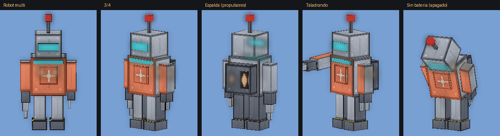

# Claude NPC — Bedrock 26.60

NPCs con forma de Claude: personaje naranja con ojos que parpadean y un emblema de estrella luminoso, de diseño propio (no es el logo oficial). **Cada Claude tiene su propia personalidad** y hace lo que quiere: pelea con espada y escudo, construye, mina, tala, pesca, cultiva, rema en bote, se hace su casa y va a clase con **Claude Maestro** o con maestros genios (Einstein, Tesla, Curie, Newton y Lovelace). Lo que estudian en clase se vuelve **habilidades con niveles** (redstone, reflejos, construcción, arco, perlas, vuelo, química...) y cada nivel desbloquea una variante nueva. Cuando se juntan dos o tres maestros construyen una **escuela, preparatoria o universidad**. Su IQ sube hasta 1000: con **IQ 500**, cinco Claudes construyen un **robot** y lo manejan; con **IQ 1000**, cinco Claudes se fusionan en **Claude Golden**. Además está el **Robot multi**, un robot constructor con batería que aplana el terreno de los maestros y, en la pelea, construye rampas, puentes y túneles para que los Claudes te alcancen. Namespace `claudenpc`.

## Instalación

1. Abre `dist/ClaudeNPC.mcaddon` con Minecraft y activa el paquete de comportamiento en el mundo.
2. Genera a Claude con el huevo "Generar a Claude" y al maestro con "Generar a Claude Maestro" (o `/summon claudenpc:claude` y `/summon claudenpc:maestro`).
3. Para que te ataquen: PvP activado y estar en Supervivencia o Aventura.
4. Comandos (operador): `/claudenpc:clase` hace que el maestro más cercano empiece la clase ya; `/claudenpc:maestro einstein` (o `tesla`, `curie`, `newton`, `lovelace`, `maestro`) trae a ese maestro (con trucos); `/claudenpc:iq 500` o `/claudenpc:iq 1000` (con trucos) pone el IQ de los Claudes cercanos, para probar el robot o la fusión con 5 Claudes; `/claudenpc:robot` (con trucos) hace que los Claudes más cercanos (hasta 5, con cualquier IQ) construyan el robot ya.
5. **Toca a un Claude** (botón "Habilidades" en el celular) para ver qué sabe: cada tema con sus estrellas, la última variante que aprendió y si lo perfecciona o solo lo estudia.

## Novedades de la v7.4: Robot multi

| Antes | Ahora |
|---|---|
| Los maestros construían sin romper todo: quedaban montañitas de tierra dentro del aula | El maestro arma un **Robot multi** junto a la obra (martillazos y chispas). El robot **localiza el terreno** (vuela a las cuatro esquinas escaneando el borde con un láser), dice cuántos bloques hay que picar y rellenar, y **aplana rompiendo todo lo que estorba** dentro del aula: tierra, piedra, árboles, bloques sueltos y también la tierra que había justo donde van las paredes. Nunca rompe cofres, barriles, camas, generadores ni bloques de comando. El maestro **espera** ("esperando al robot multi (aplanando 40 %)") y después construye. |
| Si quedaba algo, se quedaba | Mientras el maestro construye, el robot **vigila la obra**: si ve un bloque que sobra o una montañita, **abre la puerta, entra y lo rompe desde dentro**. Respeta lo ya construido y el andamio de tierra del maestro. Al terminar la obra dice "¡trabajo terminado!", se apaga y se desarma (deja 2 lingotes de hierro). En la escuela, el mismo robot aplana después el pórtico y la plaza. |
| La fachada de la escuela dejaba aulas sin aplanar | La escuela se registraba como un cuadrado enorme que tapaba las aulas, y el aula creía que su terreno era "de otra obra". Ahora se registra con su **rectángulo exacto** (pórtico y plaza) y el aula no cuenta la fachada de su propia escuela (también en mundos de versiones anteriores). |
| Tardaban demasiado en subir hacia ti | **Piensan más rápido** (cada 0,7 s con poco IQ y 0,3 s con mucho) y **construir es lo primero**: si estás arriba y cerca, casi siempre hacen la torre. La torre sube a ritmo de jugador (unos 3 bloques por segundo). |
| Parecía que retrocedían | El juego les perdía el rastro a los 16 bloques y se ponían a pasear. Ahora te **siguen hasta 48 bloques** sin soltarte y, si su IA no los acerca, **corren directo hacia ti** con su propio paso (abren puertas, suben escalones y rodean paredes). |
| Si no te alcanzaban, se quedaban abajo | **Robot multi en la pelea**: dos Claudes te olvidan un momento y lo arman mientras los demás siguen peleando. El robot mira la situación y elige una combinación de construcción (ver abajo). |
| El robot de pelea te olvidaba al alejarte | **Memoria de objetivo**: te ve desde 96 bloques y, una vez que te fija, te sigue hasta 160 bloques y hasta un minuto sin verte. |
| La metralla parecía no hacer daño | Después de cada golpe el jugador es invulnerable medio segundo, y casi todas las balas se perdían. Ahora los aciertos se **suman** y el daño entra en ráfagas (unos 6 corazones por ráfaga completa sin armadura), con menos dispersión. |

### Robot multi (no es el Robot de los Claudes)

Son robots distintos: el **Robot de los Claudes** (IQ 500) es el de pelea, con misiles, láser y metralla, y lo pilotan cinco Claudes. El **Robot multi** no tiene armas: vuela con propulsores, pica con el taladro, coloca bloques con la pinza y escanea con el visor.

- **Batería arriba del nombre**: `[||||||||||] 100%` en verde, amarilla bajo 50 % y roja bajo 20 %. Gasta por cada bloque (mucho más en la pelea que aplanando) y por el tiempo encendido. Sin batería se apaga ("¡batería agotada!") y se desarma.
- **Para los maestros**: lo arma el maestro → localiza el terreno → aplana → vigila la obra hasta que el maestro termina. Si el robot se rompe antes de terminar, el maestro aplana lo que falte él mismo.
- **En la pelea**: si algún Claude lleva 5 s sin poder alcanzarte (estás arriba o está atascado) y hay al menos dos peleando, **dos Claudes dejan de atacarte** y lo arman con martillo y llave inglesa (bloques de hierro y cobre que se vuelven el robot). Combinaciones:

| Situación | Combinación |
|---|---|
| Un Claude no puede escalar (pared de dos bloques o techo encima) | **Desatascar**: quita el bloque de arriba para dejar un escalón, o el techo |
| Estás más arriba | **Rampa** de escalones de piedra hasta tu altura, con soportes y techo libre (o **escalera de caracol** si la rampa no cabe) |
| Estás más abajo | **Bajada**: escalera excavada hacia ti |
| Hay un hueco, agua o lava en medio | **Puente** de tablas de dos de ancho |
| Hay una pared o una montaña en medio | **Túnel** de 2 × 2 |

- Respeta las casas y aulas de los Claudes, no rompe su propia rampa al volver a pensar y se apaga solo cuando la pelea termina. Como mucho hay 3 a la vez y en la misma pelea se arma uno cada 2 minutos.

## Novedades de la v7.3

| Antes | Ahora |
|---|---|
| Los maestros se ponían a picar sin más | Primero **estudian el terreno**: recorren las cuatro esquinas del área mirando el suelo, marcan el borde con luces cian, cuentan cuántos bloques hay que picar y cuántos rellenar y lo dicen ("Estudié el terreno: hay que picar 120 bloques y rellenar 35"). Después aplanan y construyen. |
| Tardaban en abrir la puerta | Abren las puertas **antes de llegar** (miran 1,4 bloques delante, también en diagonal). Mientras construyen, la puerta del aula queda abierta y la cierran al terminar; y en cuanto la ponen, la ruta ya pasa por ella. |
| Se atascaban en los postes de luz | **Ya no hay postes**: la luz son antorchas en la pared, a los lados de la puerta. En la escuela, las columnas del pórtico quedan fuera del paso y los maestros trabajan la plaza desde el borde. |
| Los alumnos se atascaban en la puerta | **Puerta doble** en todas las aulas y **dos carriles**: los de la izquierda entran y salen por una hoja y los de la derecha por la otra. Los que se quedan de pie esperan pegados a las paredes. Camino de dos de ancho. |
| El robot caminaba y el jugador se escapaba | **Corre casi siempre** (solo camina cuando ya te tiene encima) y más rápido en cada fase. Si te alejas más de 12 bloques, hace una **embestida**: se agacha, prende los cohetes de la espalda y se lanza hasta 16 bloques hacia ti rompiendo lo que haya en medio. |
| Cinemática en planos generales | **Cinemática por planos con transiciones suaves**: un Claude agarra un bloque de hierro → un Claude trabaja con el destornillador → un Claude martilla un bloque de hierro → un Claude aprieta con la llave inglesa → aparece el robot ya construido, con los cinco arriba. |
| Sonidos del juego | **Sonidos nuevos** (de los videos que mandaste): golpes de martillo en el plano del martillo, el sonido metálico de la palanca en el de la llave inglesa y una serie de martillazos cuando aparece el robot (`RP/sounds/claudenpc`). |

> Los sonidos `martillo`, `martillando` y `palanca` salen de dos videos de TikTok que mandaste (uno parece el golpe de la palanca de Half-Life). Úsalos en tu mundo; si vas a publicar el add-on, cámbialos por sonidos propios o con permiso.

## Novedades de la v7.2: el robot, a lo grande

| Antes | Ahora |
|---|---|
| El robot se armaba sin más | **Cinemática de 10 segundos** al llegar a IQ 500: los cinco Claudes sacan **martillo, destornillador y llave inglesa** y arman el robot **pieza por pieza**. Cada pieza aparece primero como un **holograma cian** y luego se materializa con chispas y un destello; los que trabajan arriba vuelan con **botas cohete**. La cámara cambia de plano con **fundidos** (general, piernas, torso y brazos, cabina, encendido), un destello blanco transforma los bloques en el robot y los cinco **se suben de un salto**. Mientras dura, no recibes daño. |
| Solo caminaba | **Corre** cuando estás lejos (zancada larga, torso inclinado, brazos que van y vienen); cada paso levanta polvo y **hace temblar la cámara**. |
| Golpe flojo | **Golpe nuevo**: se lanza con todo el cuerpo, alterna el puño izquierdo y un revés con la minigun, y el impacto se siente (onda, chispas, temblor y un buen empujón). |
| La metralla no salía de la ametralladora | Las balas salen **de la boca de la minigun del brazo derecho** (antes salían del lado izquierdo y más abajo): ráfaga de **balas trazadoras** con fogonazo y **casquillos** que caen; las que fallan levantan polvo donde pegan. |
| Una sola forma de pelear | **Fases por IQ**: empieza con el IQ promedio de sus pilotos y, al perder un tercio de su vida (y otro tercio), hace una **¡SOBRECARGA DE IQ!** (+200): se detiene, levanta los brazos, todo tiembla, te empuja y **cambia de color**. Cada fase corre más rápido, ataca más seguido y suma habilidades (ver abajo). |

Vista de los modelos: `source/vista_robot.png`.

## Novedades de la v7.1: escuelas que sí se terminan

| Antes | Ahora |
|---|---|
| Al volver a entrar al mundo, el maestro empezaba su obra desde cero y lo primero que hacía era limpiar el terreno: **demolía lo que ya había construido** y nunca terminaba | Al retomar una obra **se salta lo que ya está hecho** y sigue donde iba. Nunca deshace sus propios bloques. |
| Si un bloque no se podía poner (agua que volvía a entrar, hojas, tierra), lo saltaba y daba el aula por lista aunque estuviera a medias | Al terminar **revisa el plano entero** (hasta dos veces) y repone todo lo que falte. |
| Un maestro nuevo adoptaba un aula a medias como si estuviera lista | Primero **la termina y la revisa**; después da clase. Las aulas de versiones anteriores se revisan una vez al cargar el mundo (así se arreglan las que quedaron incompletas). |
| Construían sobre el terreno tal como estaba | **Primero preparan el terreno**: "aplanando el terreno" pican todo lo natural que sobresale (tierra, arena, piedra y árboles enteros) en el área de la obra y 2 bloques alrededor, y rellenan los huecos y el agua poco profunda de abajo hasta dejar una explanada firme. Después construyen. Así pueden construir en cerros y desniveles. |
| — | Las casas de los Claudes, sus obras especiales (jardín, torre vigía, estatua, fuente) y la fachada de la escuela también aplanan antes. Solo pican terreno natural: nunca bloques construidos ni otras obras. |

Vistas de la simulación: `source/vista_terreno.png` (antes y después) y `source/vista_escuela_terreno.png` (universidad sobre un cerro).

## Novedades de la v7

| Antes | Ahora |
|---|---|
| Con IQ 500 no construían el robot | Ya no hace falta que los cinco estén libres a la vez: **dejan la clase, la obra o la mina** y van. Si el sitio tiene árboles o bloques, primero **lo despejan** (talan y quitan) y luego lo construyen. Aparece un aviso **(N/5) Claudes con IQ 500** cada vez que otro llega a 500. Comando `/claudenpc:robot` para probarlo. |
| Se atascaban al querer salir | Si están dentro de una casa o un aula, **salen por la puerta** (y entran por ella). **Abren puertas y portones** al pasar y los cierran detrás. Si una pared les cierra el paso, **buscan un camino alrededor** (rodean muros, suben escaleras, cruzan puertas). Si quedan en un pozo sin salida, **hacen una torre** para salir. |
| Los escalones a veces no los subían | El salto para subir un bloque ahora es **guiado**: siempre llega arriba. |
| No subían en torre: se quedaban mirando arriba | La torre usa el mismo salto guiado: **se centran, miran abajo, saltan y ponen el bloque bajo sus pies** en lo alto del salto. Si fallan un bloque, caen y lo vuelven a intentar. |
| El robot chocaba con los árboles | **El robot rompe todo lo que se le pone delante**: troncos, hojas, muros, cercas y casas (no el suelo ni las obras de los Claudes). Los troncos los pisa y se rompen. |
| Cada maestro tenía su aula sola | **Dos maestros juntos construyen una ESCUELA** (o una **PREPARATORIA** si uno es un genio) y **tres, una UNIVERSIDAD**, más grande: aulas pegadas, pórtico con columnas, plaza, gran letrero con los profes y un campanario con campana. Cada profe da clase en su propia aula. |
| Las clases solo subían el IQ | Cada tema se convierte en una **habilidad con niveles**. Cada nivel desbloquea una **variante nueva** (más combinaciones de redstone, distintos tipos de reflejo, distintas construcciones...). **Unos Claudes solo estudian** el tema y otros **lo perfeccionan**, según su personalidad y su talento, y lo perfeccionan **practicando** en su tiempo libre. |
| — | Nueva lección **Reflejos** (y los genios Einstein y Newton enseñan la luz): copias de luz, cambio de lugar, destello cegador y contraataque. |
| — | **Dúo de viento**: cuando un Claude saca las elytras, otro Claude cercano se da cuenta y le lanza **cargas de viento** para que vuele mucho más alto; la picada con la maza en dúo **pega x1,5**. |

## Novedades de la v6

| Antes | Ahora |
|---|---|
| No podían subir un bloque y se quedaban trabados | Saltan los escalones de un bloque; si el salto no alcanza, terminan de subir solos. Vale para todos los Claudes y los maestros. |
| Se estancaban picando o construyendo | La mina avanza con pasos reales (sube escalones), cambia de rumbo si no puede romper algo y, si sigue trabada, sale a la superficie con una perla. No insisten más de 2 veces con el mismo bloque, y dejan una torre o un puente si no pueden seguir. |
| La fusión era con IQ 300 | El IQ sube hasta **1000**: la habilidad para pelear y construir llega a su tope en 300, con **500** cinco Claudes construyen el **robot** y con **1000** se fusionan en **Claude Golden**. |
| Un solo maestro | Hay **maestros genios con IQ 500** inspirados en científicos reales: **Einstein, Tesla, Curie, Newton y Lovelace**. Cada uno tiene su aspecto, da clases de su ciencia y enseña más rápido (los alumnos salen aprendiendo el triple). |
| — | **Robot de los Claudes**: cinco Claudes con IQ 500 te buscan, lo construyen con bloques frente a ti, se suben y lo manejan durante 5 minutos (ver abajo). |

## Novedades de la v5

| Antes | Ahora |
|---|---|
| Claude Golden no era hostil | Es un **jefe hostil**: te persigue volando, se lanza a golpearte con la palma dorada, te devuelve las flechas y usa 12 poderes creativos (ver abajo). Con la mitad de vida entra en **fase 2 (IQ al 200%)**. |
| Esfera de fusión pálida | **Esfera dorada luminosa**: cáscara de oro translúcida con meridianos y anillos que brillan, chispas doradas y luz real alrededor. |
| Ojo normal | **Su ojo derecho brilla** con un esplendor reluciente: núcleo blanco que late, rayos en cruz que giran y destellos pegados al ojo (más grandes en fase 2). |
| Al pegarte o tirarte flechas retrocedían "temblando" | Sin pasos atrás bruscos ni tirones: para mirarte ya no se teletransportan. A media distancia te rodean con un paso lateral suave y al tensar el arco caminan despacio sin quitarte la vista. |
| La clase no subía el IQ de 280 | Las clases suben el IQ **hasta 300**. |
| Se transformaban al instante | Los 5 genios te avisan, **te buscan**, se ponen en círculo frente a ti y recién ahí empieza la danza y la cinemática (si alguno se atrasa, llega con una perla). |
| Después de clase se quedaban encerrados picando | Al terminar se levantan y **salen en orden por el pasillo y la puerta**, que el maestro deja abierta hasta que salgan todos. Ya no minan ni rompen bloques dentro o al lado de sus casas y del aula. |

## Novedades de la v4

| Antes | Ahora |
|---|---|
| Tardaba mucho en construir | Construye a ritmo de jugador rápido (4-6 bloques por segundo) y, con más IQ, encadena 2 o 3 bloques seguidos. Puentes, torres, talar y craftear también son más rápidos. |
| En el agua se quedaban tiesos | En el agua nunca se quedan quietos: nadan hacia la orilla (o hacia ti) y salen saltando. El bote comprueba que de verdad va montado; si falla o se atasca, se baja y sigue nadando, sin repetir. |
| Todos minaban y ponían bloques igual | Cada Claude tiene personalidad, gustos, ritmo y bloque propios, y elige qué hacer sin repetirse (ver abajo). |
| No rompían tu pared | Reconocen los bloques que pones y los rompen con la herramienta correcta (pico, hacha, pala, tijeras o la mano) en el tiempo que tardaría un jugador; si se atascan, se abren paso en escalón hacia ti. No rompen bedrock ni bloques de comando, ni obsidiana sin pico de diamante, ni sus propias casas o el aula. |
| Golpes sin animación | Cada golpe cuerpo a cuerpo tiene animación según el arma: espadazo (alterna derecha y revés), hachazo o estocada con tridente. |
| Atacaban con el escudo | El escudo ya no golpea. Atacan con espada (casi siempre). El escudo va en la otra mano y lo **levantan cuando les apuntas con arco, ballesta o tridente** (o ven venir un proyectil): caminan despacio y las flechas que llegan por delante rebotan. Con más IQ reaccionan antes; para atacar lo bajan. |

## Habilidades

Al terminar una clase, los alumnos suben la habilidad del tema (con un maestro genio, un 40 % más). Cada nivel desbloquea una variante y las anteriores siguen disponibles (la más nueva sale más a menudo). Usarlas y practicarlas también las mejora.

| Habilidad | Niveles (variantes que desbloquea) | Se aprende en |
|---|---|---|
| Construcción | 1 casa · 2 **jardín** con cerca y flores · 3 **torre vigía** con mirador · 4 **estatua de Claude** · 5 **fuente** | Construcción; Einstein (imaginación); Lovelace (ciencia poética) |
| Redstone | 1 torreta de flechas · 2 **torreta doble** · 3 **torreta de TNT** · 4 **cañón de TNT** (te lanza TNT encendida en arco) · 5 **bobina de Tesla** (marca el suelo bajo tus pies y cae un rayo: ¡muévete!) | Redstone, Trampas; Tesla; Lovelace (bucles) |
| Reflejos | 1 **reflejo señuelo** (una copia de luz con su nombre corre hacia ti) · 2 dos reflejos · 3 **cambio de lugar** con un reflejo · 4 **destello cegador** · 5 **contraataque** (a veces tu golpe le da a un reflejo; él esquiva y te pega) | Reflejos; Einstein (fotones); Newton (luz) |
| Escudo | 1 reacción más rápida · 2 aguanta más tras el escudo · 3 **devuelve las flechas** | Escudo |
| Vuelo | 1 elytra y maza · 2 **dúo de viento** · 3 impulso de viento propio al despegar · 4 **doble picada** | Elytra y maza; Newton (gravedad) |
| Arco | 1 puntería · 2 **flechas de fuego** · 3 **tres flechas** · 4 tiro perfecto · 5 **lluvia de flechas** | Arco; Newton (leyes del movimiento) |
| Perlas | 1 perla · 2 aparece a tu espalda · 3 **doble perla** · 4 **perla y golpe** | Perlas; Einstein (relatividad) |
| Torres y puentes | 1 torre más rápida · 2 puente rápido · 3 sin fallar (y más alta) | Torres, Puentes |
| Minería | 1 pico rápido · 2 **olfato de minerales** (en el túnel va hacia las vetas) · 3 **veta completa** | Minería |
| Agua | 1 clutch · 2 nada rápido · 3 respira bajo el agua | Water drop |
| Cálculo | 1 aprende un 15 % más rápido · 2 predice tu movimiento al disparar · 3 reacción veloz | Matemáticas; Curie (dos Nobel); Lovelace (algoritmos) |
| Química | 1 poción de velocidad · 2 de fuerza · 3 regeneración (cuando está herido) · 4 **te lanza veneno** · 5 resistencia al fuego | Curie |

**Solo estudian o perfeccionan.** Cada Claude tiene un talento distinto para cada tema (según su personalidad y un poco de azar): con mucho talento llega al último nivel; con poco, se queda en el 2 o el 3 aunque siga yendo a clase. Por ejemplo, el inventor perfecciona la redstone, el constructor la construcción, el arquero el arco, el guerrero los reflejos y el escudo, el explorador el vuelo y las perlas, y el pescador el agua. Los que todavía pueden mejorar **practican** en su tiempo libre: tiro al blanco, una lámpara de redstone que prende y apaga, reflejos, pociones en un soporte, saltos con viento, el escudo...

## Personalidades

Al nacer, cada Claude recibe una personalidad (se evita repetir la de los Claudes cercanos) con valores variados al azar. Se ve sobre su cabeza junto a lo que está haciendo.

| Personalidad | Le gusta | Al pelear prefiere |
|---|---|---|
| Minero | Minar en escalera y túnel, craftear | Cavar, trampas |
| Constructor | Hacer su casa enseguida, decorar (faroles, flores, bancos) | Torres y puentes, torretas |
| Explorador | Recorrer el terreno, mirar el paisaje, pasear en bote | Perlas, elytra, arco |
| Leñador | Talar árboles y replantar | Salto con maza |
| Granjero | Huerto 3x3 con agua y trigo: ara, siembra, cosecha y usa polvo de hueso | Arco, trampas |
| Pescador | Pescar en la orilla (bacalao, salmón, a veces un tesoro) y remar | Bote, arco |
| Arquero | Explorar y observar | Arco (mucho) |
| Inventor | Craftear y decorar | Torretas y trampas de redstone |
| Dormilón | Sentarse a descansar (zzz) | Poco: solo si te acercas mucho |
| Guerrero | Explorar y minar | Maza, elytra, salto al vacío |

Además: cada uno tiene su radio para fijarse en ti (de 12 a 32 bloques), su velocidad, su profundidad de mina, el bloque de sus torres y puentes (piedra, roble, ladrillo de piedra, arenisca...) y el estilo de su casa (roble, abeto, abedul, piedra o ladrillo). Si lo golpeas, pelea aunque estuviera tranquilo. De noche vuelve a su casa a dormir.

## Claude Maestro (IQ 280) y los maestros genios (IQ 500)

No ataca. Lleva lentes, cabello formal peinado de lado, saco de tweed con coderas, camisa, corbata, una insignia luminosa y un libro.

1. **Prepara el terreno** (pica lo que sobra y rellena los huecos) y **construye un aula** como un jugador: piso de abedul, paredes blancas con ventanales, techo con luces, pizarra negra con marco y tres carteles, mesa con campana, atril, estanterías, 12 pupitres con su silla, pasillo con alfombra, puerta, cartel "AULA", camino y faroles. Si no puede construir, da la clase al aire libre.
2. **Toca la campana** (la primera clase a los ~30 s, luego cada 2-3 minutos). Los Claudes a menos de 64 bloques **dejan de perseguirte** y de hacer lo que hacían, van a clase por la puerta y el pasillo y se sientan mirando la pizarra (si alguno se atasca, llega con una perla de ender).
3. **La clase dura ~75 s**: escribe el tema en la pizarra letra por letra, explica tres ideas (las ves en la barra de acción), señala alumnos, escribe los apuntes, hace una pregunta (un alumno levanta la mano y, si acierta, aplausos) y deja tarea. Los alumnos toman apuntes y suben de IQ todo el rato (hasta 300).
4. Al terminar, se levantan y salen en orden por la puerta con **bono x2: aprenden el doble durante 5 minutos** (sale "x2" junto a su IQ), usan más la táctica de la lección y **suben la habilidad del tema** (torres, puentes, arco, escudo, water drop, redstone, trampas, perlas, elytra, construcción, minería, reflejos o matemáticas).

**Tócalo** (botón "Hablar") para ver su estado y la próxima lección, o para empezar la clase en ese momento. Si lo golpeas suspende la clase y los Claudes cercanos lo defienden.

### Escuela, preparatoria y universidad

Si un maestro nuevo aparece cerca (a menos de 48 bloques) del aula de otro maestro, construye **su aula pegada a esa**, con el mismo piso y la misma orientación, y los techos quedan unidos:

| Maestros | Qué construyen |
|---|---|
| 2 | **ESCUELA DE LOS CLAUDES** (o **PREPARATORIA** si uno de los dos es un genio): dos aulas, pórtico blanco con columnas de cuarzo y techo, plaza con bancas y macetas, y un gran letrero con el nombre y los profes. |
| 3 | **UNIVERSIDAD DE LOS CLAUDES**: tres aulas, un pórtico a lo largo de todas, una plaza más grande y un **campanario** de 12 bloques con campana (lo levantan desde un andamio que después quitan). |

Cada maestro da su clase en su propia aula y a su ritmo. Al tocar a un maestro verás a qué escuela pertenece. Vista del plano: `source/vista_universidad.png`.

### Maestros genios

Con el huevo de Claude Maestro, la mitad de las veces sale el maestro normal y la otra mitad un genio (o tráelo con `/claudenpc:maestro <nombre>`). Enseñan casi el doble de rápido y, después de su clase, los alumnos aprenden el triple durante 5 minutos (verás "x3" junto a su IQ).

| Maestro | Aspecto | Enseña |
|---|---|---|
| Claude Einstein | Pelo blanco alborotado, bigote, cárdigan | Relatividad (E = mc², la velocidad de la luz), imaginación y fotones |
| Claude Tesla | Pelo negro engominado, bigote, traje oscuro | Corriente alterna, la bobina de Tesla y magnetismo (suelta chispas) |
| Claude Curie | Moño, vestido negro con cuello blanco | Radiactividad, sus dos Premios Nobel y seguridad en el laboratorio (brillo verde) |
| Claude Newton | Peluca blanca de rizos, levita, medias y hebillas | Gravedad, las tres leyes del movimiento y la luz (a veces le cae una manzana) |
| Claude Lovelace | Tirabuzones, vestido morado con encaje | Algoritmos, bucles y la "ciencia poética" de las máquinas |

## IQ

Encima del nombre lleva su **IQ** (de 70 a **1000**). Sube cuando te ve construir, romper o subir en torre, cuando recibe golpes y flechas, cuando bloquea una flecha, cuando una táctica le funciona, al minar, talar, pescar, cultivar, explorar o terminar su casa, y sobre todo en clase. Se guarda: un Claude nuevo hereda gran parte de lo aprendido. Hasta 300 mejora su habilidad (piensa más rápido, apunta mejor, levanta antes el escudo, construye más rápido y desbloquea tácticas: perla 85, water drop 100, clutch 110, torreta 110, trampa 120, elytra + maza 125). Con **500** (rojo) cinco Claudes construyen el robot y con **1000** (dorado) se fusionan.

## Robot de los Claudes (IQ 500)

1. Cada vez que otro Claude llega a IQ 500 verás cuántos van: **(3/5) Claudes con IQ 500**. Cuando hay cinco, **dejan lo que estaban haciendo** (clase, obra, mina), avisan ("¡IQ 500 × 5!"), te buscan y eligen un sitio a unos 13 bloques de ti, del lado donde estaban ellos.
2. Si hay árboles o bloques en el sitio, primero **lo despejan** con el hacha, la pala o el pico. Después **lo construyen con bloques**, por turnos: piernas de hierro, torso con núcleo de redstone y placas de cobre, brazos, lanzamisiles en los hombros y una cabina de vidrio con visor.
3. Saltan chispas, los bloques **se transforman en el robot** y los cinco **se suben**: uno en la cabina, dos sobre los hombros y dos en la espalda.
4. El robot te persigue durante **5 minutos** (verás su vida arriba y el tiempo que le queda) y **rompe todo lo que se le pone delante**: troncos, hojas, cercas, muros y casas (el suelo natural no, para subir cuestas en vez de cavar zanjas; tampoco las casas y aulas de los Claudes):

| Arma | Cómo esquivarla |
|---|---|
| Misiles teledirigidos desde los hombros | Corre de lado: giran despacio |
| Láser del visor que barre el suelo (se carga 1 s) | Sal de la línea del rayo |
| Metralla de flechas desde el brazo | Escudo o cúbrete |
| Pisotón con onda expansiva | Salta cuando pase la onda |
| Puñetazo si estás cerca | Aléjate |

5. **Fases por IQ** (el nombre de la barra de jefe muestra el IQ y la fase):

| Fase | IQ | Colores | Habilidades nuevas |
|---|---|---|---|
| Prototipo | 500 | naranja con visor cian | misiles, láser, metralla, pisotón y golpe |
| Turbo | 700 | rojo con visor rojo y fuego por los escapes | **Salto aplastante** (anillos rojos donde vas a estar, salta 9 bloques y cae encima: ¡muévete!), **Puño cohete** (el antebrazo sale volando, te golpea y vuelve) y **Lluvia de tornillos** (marcas rojas en el suelo: sal de ellas) |
| Genio | 900 | dorado con visor blanco y chispas doradas | **Escudo de energía** (cúpula de hexágonos 6 s: devuelve tus flechas y aguanta la mitad del daño), **Láser giratorio** (un anillo láser a la altura de las rodillas da una vuelta entera: **sáltalo**) e **Imán** (te atrae hacia él y luego pisotea: corre en contra) |

6. A los 5 minutos suena la **alarma** y se **autodestruye** con una gran explosión (no rompe bloques): aléjate. Los Claudes saltan a tiempo y no construyen otro hasta 20 minutos después. Si lo destruyes antes, deja hierro, redstone, cobre y diamantes.

## Combate

Se mueve como un jugador (camina, corre, salta al correr y te rodea con pasos laterales suaves, sin tirones), cambia de arma de vez en cuando (casi siempre una espada) y elige entre alternativas según la situación, lo que aprendió de ti, su personalidad y sus habilidades: torre, puente, bote, arco con puntería predictiva, perla de ender, elytra + maza (en dúo de viento con otro Claude), salto al vacío con water drop, cavar, salto con maza, trampas, torretas y cañones de redstone, reflejos, pociones y abrirse paso rompiendo tu pared. Una habilidad aprendida en clase desbloquea su táctica aunque el Claude tenga poco IQ, y cuanto más nivel tiene, más la usa.

Para caminar abren puertas y portones, salen de casas y aulas por la puerta, rodean paredes buscando por dónde pasar y suben escalones con un salto que siempre llega. Una vez que pelean, te siguen hasta 48 bloques y, si no logran acercarse, corren directo hacia ti. Si no pueden alcanzarte, dos de ellos arman un **Robot multi** que les construye el camino.

## Fusión y Claude Golden

Cuando hay **cinco Claudes con IQ 1000** (y no están en clase ni en el robot), dejan lo que hacían y **te buscan**. Se colocan en círculo frente a ti, bailan una danza propia, los envuelve una **esfera dorada luminosa** y, tras una **cinemática de 10 s**, nace **Claude Golden**.

**Claude Golden** (300 de vida, jefe hostil) brilla entero, su **ojo derecho** despide un destello que gira y late, y lleva **IQ: ???** con letras que rebotan en colores. Al verte chasquea los dedos: se hace de noche y empieza la pelea. Verás su vida en la barra de acción.

| Poder | Qué hace | Cómo salvarte |
|---|---|---|
| Lluvia de ideas | Caen bombillas de luz donde estás y donde vas a estar | Sal de los círculos del suelo |
| Estrella fugaz | Sube brillando, cae en picada y salen dos ondas de luz por el suelo | Salta cuando pase la onda |
| Ascensor dorado | Una columna de oro te sube 12 bloques y luego se deshace | Sal del círculo dorado (o haz water drop) |
| Tu reflejo | Un espejo de luz y tu reflejo, que copia tus pasos al revés | Pégale tú primero y se rompe |
| Ctrl + Z | Deshace los bloques que pusiste en los últimos 30 s y te devuelve 3 s atrás | No confíes en tu torre |
| Sol de bolsillo | Un sol pequeño te persigue y te quema al aire libre | Escóndete bajo un techo |
| Agujero de oro | Una singularidad que lo atrae todo y al cerrarse explota | Corre en dirección contraria |
| Partitura | Notas musicales que te persiguen, girando despacio | Muévete de lado en el último momento |
| Jaque | El suelo se vuelve un tablero de oro y negro; estalla un color | Cámbiate de color o salta |
| ¿Cuál soy yo? | Se divide en tres que cambian de lugar | Encuentra al verdadero (los falsos te ciegan) |
| Gravedad al revés | Todos flotan... y caen de golpe | Water drop o caer en agua |
| Duelo de IQ | Te hace una pregunta | Si aciertas queda aturdido y recibe el doble de daño; si fallas, rayo |

Además se lanza cada tanto a golpearte (ese es el momento de devolverle el golpe), quieto mientras dirige o lee es más fácil de alcanzar, y devuelve la mayoría de las flechas. Los bloques del tablero y del ascensor vuelven a ser como eran. Si lo vences: estrella del Nether, manzanas doradas (una encantada) y experiencia.

Para que no toquen bloques de tu mundo: `BP/scripts/config.js` → `MODIFICA_MUNDO = false` (el maestro dará la clase al aire libre).

## Estado

Validado con las herramientas del kit (0 errores, 0 advertencias) y con los tipos oficiales de `@minecraft/server` 2.11.0 y `@minecraft/server-ui` 2.3.0. La búsqueda de camino se probó fuera del juego con mapas de prueba (salir de una casa por la puerta, rodear un muro, subir una escalera y detectar un pozo sin salida). El Robot multi se probó con una simulación del mundo: aplanar un aula sobre un cerro con árbol, pozo de agua, una pared de piedra y un cofre (no quedó ningún bloque sobrando y el cofre se respetó), vigilar la obra (entra por la puerta, rompe desde dentro y no toca el andamio ni lo construido) y la pelea (rampa hasta un pilar de 6, puente sobre un foso de lava y túnel por una pared). Los planos de la escuela y la universidad se revisaron con una vista 3D generada desde el mismo código (`source/vista_universidad.png`, `source/vista_escuela.png`), igual que el aula y las casas (`source/vista_aula.png`); los modelos con `source/vista_previa.png`. **No probado en el juego.** Puntos a revisar: que el Robot multi vuele fluido y pase por la puerta doble, que los Claudes usen la rampa que les hace, que el salto guiado y la torre se vean fluidos, que las puertas se abran y cierren bien, dónde quedan sentados los cinco Claudes sobre el robot, cuánto rompe el robot al avanzar, el cañón de TNT y la bobina de Tesla, los reflejos (copias de luz) y el dúo de viento con elytras.

## Regenerar arte

`python source/build_assets.py` (Pillow) regenera modelos, skins, animaciones, partículas y entidades de cliente. `python source/preview_render.py salida.png` dibuja la vista previa de los personajes (numpy).
