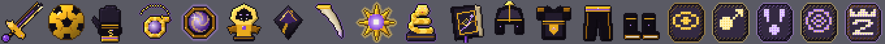
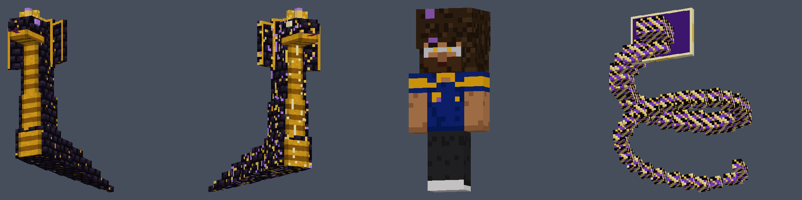

# 🐍 La Cobra Ultimate Addon — Minecraft Bedrock

Addon de **La Cobra** para Minecraft Bedrock (Android, iOS, Windows y consolas): cinco habilidades con sistema de energía, objetos exclusivos, armadura completa, un jefe con tres fases y recursos visuales y sonoros originales.

**Archivo para instalar:** [`dist/LaCobraUltimate.mcaddon`](dist/LaCobraUltimate.mcaddon) (también hay un `.mcpack` por pack en `dist/`).




## Compatibilidad

| Elemento | Valor |
|---|---|
| Versión objetivo | Minecraft Bedrock **26.60** (1.26.60, publicada el 27-10-2026). Funciona también en 26.50 |
| Script API | `@minecraft/server` **2.10.0** y `@minecraft/server-ui` **2.2.0** (estables, sin experimentales) |
| `min_engine_version` | 1.21.100 |
| Formato de objetos | 1.21.90 (componentes personalizados V2) |
| Experimentos necesarios | **Ninguno** |

Usé 2.10.0 en vez de 2.11.0 a propósito: 2.11.0 solo funciona en 26.60, que salió el día anterior, y 2.10.0 funciona tanto en 26.50 como en 26.60. El addon no necesita ninguna API nueva de 2.11.

## Documentación

| Documento | Contenido |
|---|---|
| [docs/INSTALACION_ANDROID.md](docs/INSTALACION_ANDROID.md) | Instalación paso a paso en Android |
| [docs/OBJETOS_Y_HABILIDADES.md](docs/OBJETOS_Y_HABILIDADES.md) | Las 5 habilidades, los 20 objetos, el jefe y sus números |
| [docs/CONTROLES.md](docs/CONTROLES.md) | Cómo se activa todo con la pantalla táctil, y comandos de prueba |
| [docs/RECETAS.md](docs/RECETAS.md) | Todas las recetas y la progresión (generado desde los JSON) |
| [docs/REGISTRO_PRUEBAS.md](docs/REGISTRO_PRUEBAS.md) | Qué se probó, cómo, y qué falta probar dentro del juego |
| [docs/LIMITACIONES.md](docs/LIMITACIONES.md) | Limitaciones conocidas y alternativas usadas |

## Resumen rápido

**Habilidades** (energía 0-100, se regenera 2/s):

| Habilidad | Energía | Enfriamiento | Efecto |
|---|---|---|---|
| Instinto de la Cobra | 15 | 12 s | Aura negra y dorada con mini serpientes, Velocidad II 8 s, +3 de daño por golpe |
| Remate Legendario | 25 | 6 s | Carga de 1,2 s y una esfera-balón con colisión real; onda expansiva de 14 de daño. No rompe bloques |
| Veneno Serpentino | 20 | 8 s | Serpiente de energía teledirigida: 6 de daño, Lentitud III y Veneno |
| Dominio Absoluto | 40 | 30 s | Círculo mágico con runas durante 10 s: Fuerza, Resistencia y Regeneración para ti, rayos y debilitamiento para los enemigos, y una onda final |
| **La Cobra Suprema** | 100 | 90 s | Secuencia de 7,5 s: círculo gigante, serpiente enroscada, aparición del espíritu de La Cobra y gran onda (28 de daño, radio 12) |

**Para empezar en supervivencia:** fabrica Escamas de Cobra (oro + tinta + amatista + cuero), luego un Núcleo de Energía, el Libro Táctico y tu primera Runa. Ver [RECETAS.md](docs/RECETAS.md).

## Estructura del proyecto

```
LaCobraUltimate/
├── dist/                      ← LaCobraUltimate.mcaddon + .mcpack (generados)
├── packs/
│   ├── LaCobra_BP/            ← Behavior Pack: objetos, entidades, recetas, botín, scripts/
│   └── LaCobra_RP/            ← Resource Pack: texturas, modelos, animaciones, partículas, sonidos, textos
├── tools/
│   ├── assets/                ← generadores de texturas, modelos, partículas, sonidos y JSON (Python)
│   ├── validate.mjs           ← validador de referencias cruzadas (594 comprobaciones)
│   ├── schema-check.mjs       ← validación contra los esquemas JSON de Bedrock 1.26
│   ├── build.mjs              ← valida y empaqueta el .mcaddon
│   └── test/                  ← simulador del Script API y 117 pruebas automáticas
└── docs/
```

## Compilar y probar

Hace falta Node 22+ (y Python 3 con Pillow y numpy para regenerar recursos, más ffmpeg con libvorbis para los sonidos).

```bash
npm install
npm run typecheck      # comprueba los scripts contra los tipos oficiales de @minecraft/server 2.10.0
npm test               # 117 pruebas automáticas en el simulador
node tools/schema-check.mjs   # valida los 102 JSON contra los esquemas de Bedrock
npm run build          # valida y genera dist/LaCobraUltimate.mcaddon
npm run assets         # (opcional) regenera todas las texturas, modelos, partículas y sonidos
```

Todos los valores de equilibrio (costes, daño, radios, duraciones) están en [`packs/LaCobra_BP/scripts/config.js`](packs/LaCobra_BP/scripts/config.js).

## Créditos y derechos

Todas las texturas, modelos, partículas y sonidos son **originales**: se generan por código en `tools/assets/`. No contienen grabaciones, música ni texturas de terceros. El espíritu de La Cobra usa una skin propia inspirada en la referencia (pelo afro, gafas, barba, camiseta azul y oro). Los logos de marcas y del club se sustituyeron por un emblema de serpiente y un dorsal 9. Es un proyecto de fans sin afiliación oficial.
